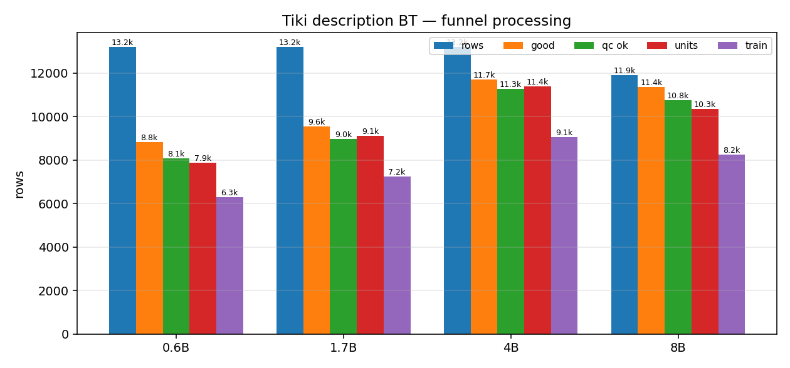
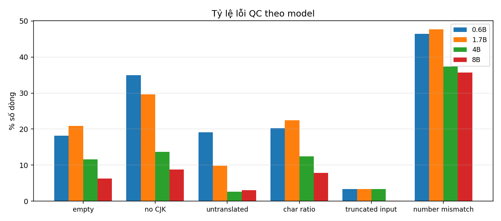
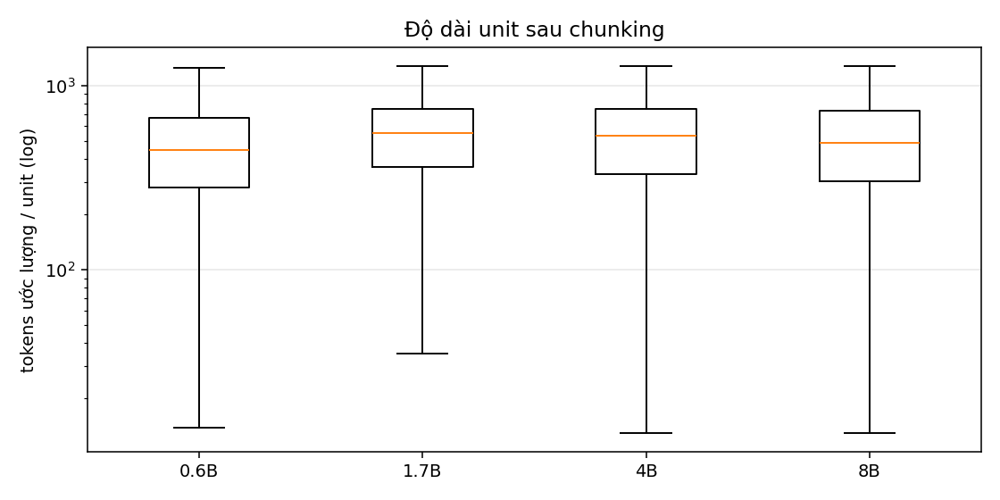

# Tiki description BT — QC & processing

**Ngày:** 2026-11-08  
**Script:** `code/process_bt_desc.py`  
**Input:** output gốc trong `data/bt/raw/description/`  
**Output:** `data/bt/description/processed/<model>/`

## 1. Funnel processing

| model | rows | good | QC ok | QC ok % | dedup bỏ | units | train | token (M) |
|---|---:|---:|---:|---:|---:|---:|---:|---:|
| qwen3-0.6b | 13.200 | 8.823 | 8.091 | 61,3% | 729 | 7.868 | 6.292 | 3,881 |
| qwen3-1.7b | 13.200 | 9.550 | 8.984 | 68,1% | 714 | 9.125 | 7.238 | 5,259 |
| qwen3-4b | 13.200 | 11.712 | 11.276 | 85,4% | 701 | 11.404 | 9.052 | 6,363 |
| qwen3-8b | 11.900 | 11.374 | 10.752 | 90,3% | 579 | 10.342 | 8.243 | 5,494 |



## 2. Lỗi QC

| model | empty | no CJK | untranslated | char ratio | truncated | number mismatch |
|---|---:|---:|---:|---:|---:|---:|
| qwen3-0.6b | 2.397 | 4.617 | 2.524 | 2.673 | 444 | 6.137 |
| qwen3-1.7b | 2.752 | 3.913 | 1.303 | 2.961 | 444 | 6.295 |
| qwen3-4b | 1.532 | 1.801 | 342 | 1.636 | 444 | 4.939 |
| qwen3-8b | 745 | 1.049 | 360 | 939 | 10 | 4.248 |



Nhận xét:

- QC pass tăng đơn điệu theo model: 61,3% → 68,1% → 85,4% → 90,3%.
- 4B và 8B giảm mạnh lỗi `empty` và `no_cjk` so với 0.6B/1.7B.
- `number_mismatch` vẫn là lỗi phổ biến nhất ở mọi model (4.248–6.295 dòng).
- `input_truncated` = 444 ở 0.6B/1.7B/4B vì cùng nguồn description dài; 8B chỉ 10
  vì 8B dừng trước, chưa xử lý các description dài nhất.
- `f_boilerplate` phản ánh boilerplate phía source (đã strip), không phải lỗi target.

## 3. Sau chunking

| model | units | train/dev/test | token (M) | sản phẩm bị chunk |
|---|---:|---|---:|---:|
| qwen3-0.6b | 7.868 | 6.292 / 797 / 779 | 3,881 | 164 |
| qwen3-1.7b | 9.125 | 7.238 / 946 / 941 | 5,259 | 433 |
| qwen3-4b | 11.404 | 9.052 / 1.185 / 1.167 | 6,363 | 499 |
| qwen3-8b | 10.342 | 8.243 / 1.064 / 1.035 | 5,494 | 21 |



## 4. So sánh công bằng 4B vs 8B

8B chỉ có 11.900/13.200 sản phẩm (dừng do time budget), thiếu 1.300 description
dài nhất: median source 1.450 ký tự (8B) so với 1.563 (4B).

Trên cùng 11.321 sản phẩm:

| model | QC ok (sau dedup) |
|---|---:|
| qwen3-4b | 89,9% |
| qwen3-8b | 91,2% |

8B nhỉnh hơn nhưng chưa phủ đủ các description dài, nên **chưa thể kết luận 8B > 4B**
cho toàn bộ 13.200 sản phẩm. Cần chạy 8B tới 13.200 trước khi dùng làm bộ final.

## 5. Dùng cho train

```text
data/bt/description/processed/qwen3-4b/train.parquet   # 9.052 unit
data/bt/description/processed/qwen3-4b/units.parquet   # 11.404 unit
data/bt/description/processed/qwen3-8b/train.parquet   # 8.243 unit (partial)
```
