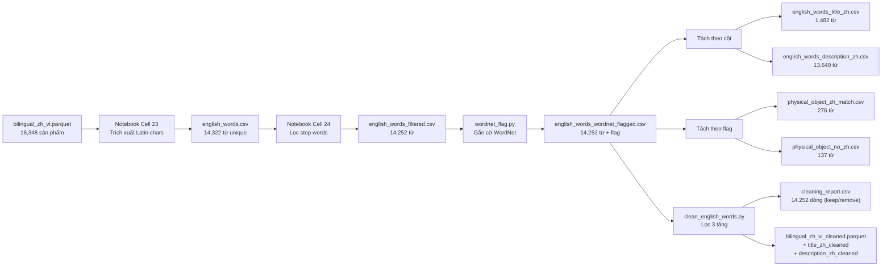
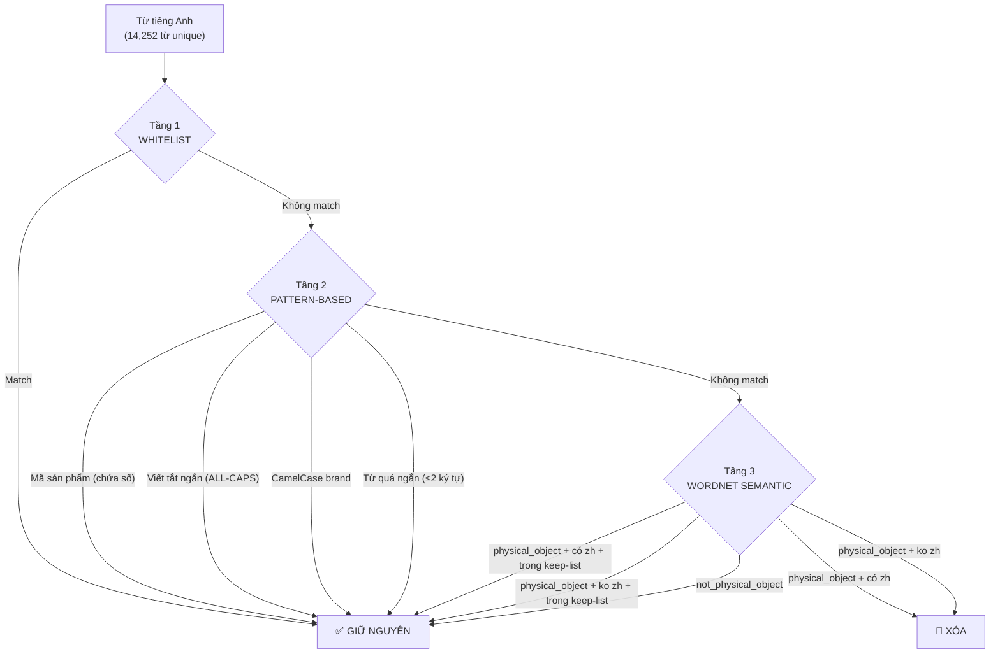
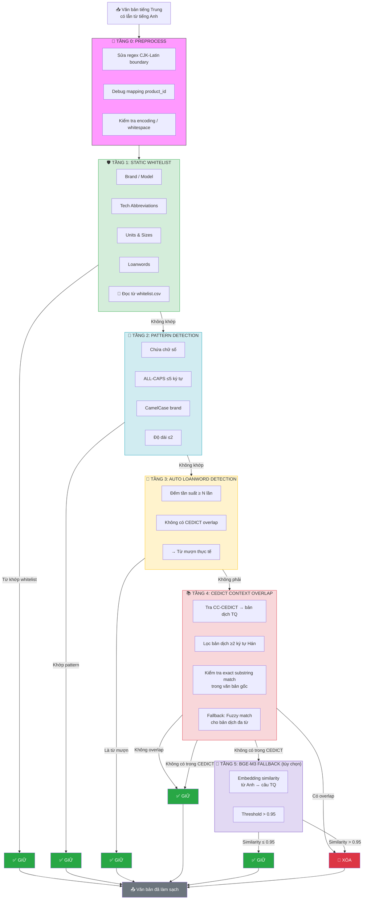

# 📖 Walkthrough — EDA Dữ Liệu Song Ngữ Trung-Việt (E-commerce 1688)

> Tài liệu ghi lại **toàn bộ quá trình khảo sát dữ liệu (EDA)**, các vấn đề phát hiện được, hướng xử lý đã thực hiện và những vấn đề còn tồn đọng trong tập dữ liệu song ngữ Trung-Việt thu thập từ sàn thương mại điện tử 1688.com.

---

## Mục Lục

1. [Tổng Quan Dữ Liệu](#1-tổng-quan-dữ-liệu)
2. [Cấu Trúc Dự Án](#2-cấu-trúc-dự-án)
3. [Quy Trình EDA Đã Thực Hiện](#3-quy-trình-eda-đã-thực-hiện)
4. [Các Vấn Đề Phát Hiện Trong Tập Dữ Liệu](#4-các-vấn-đề-phát-hiện-trong-tập-dữ-liệu)
5. [Trọng Tâm: Từ Tiếng Anh Lẫn Trong Văn Bản Tiếng Trung](#5-trọng-tâm-từ-tiếng-anh-lẫn-trong-văn-bản-tiếng-trung)
6. [Pipeline Xử Lý Từ Tiếng Anh](#6-pipeline-xử-lý-từ-tiếng-anh)
7. [Chiến Lược Lọc 3 Tầng](#7-chiến-lược-lọc-3-tầng)
8. [Kết Quả Sau Xử Lý](#8-kết-quả-sau-xử-lý)
9. [Các Vấn Đề Còn Tồn Đọng](#9-các-vấn-đề-còn-tồn-đọng)
10. [Kiến Trúc CADO — Xử Lý Từ Tiếng Anh Thế Hệ Mới](#10-kiến-trúc-cado--xử-lý-từ-tiếng-anh-thế-hệ-mới)
11. [Chi Tiết Từng Tầng Xử Lý](#11-chi-tiết-từng-tầng-xử-lý)
12. [Phân Tích Rủi Ro & Biện Pháp Giảm Thiểu](#12-phân-tích-rủi-ro--biện-pháp-giảm-thiểu)
13. [Lộ Trình Triển Khai](#13-lộ-trình-triển-khai)
14. [Kết Quả Thực Nghiệm CADO (T0-T5)](#14-kết-quả-thực-nghiệm-cado-t0-t5)

---

## 1. Tổng Quan Dữ Liệu

### 1.1 Nguồn gốc

Dữ liệu được crawl từ sàn TMĐT **1688.com** (Alibaba nội địa Trung Quốc), bao gồm thông tin sản phẩm song ngữ Trung-Việt. Đây là tập dữ liệu phục vụ cho bài toán **dịch máy / căn chỉnh song ngữ** trong lĩnh vực thương mại điện tử.

### 1.2 Quy mô

| Chỉ số | Giá trị |
| :--- | :--- |
| Tổng sản phẩm | **16,348** |
| Số cột (fields) | **30** |
| File gốc | [`bilingual_zh_vi.parquet`](bilingual_zh_vi.parquet) (~24.4 MB) |

### 1.3 Cấu trúc cột (Schema)

| Cột | Kiểu | Null | Mô tả |
| :--- | :---: | ---: | :--- |
| `product_id` | str | 0 | Mã sản phẩm trên 1688 |
| `title_zh` | str | 0 | Tiêu đề tiếng Trung |
| `title_vi` | str | 0 | Tiêu đề tiếng Việt (đã dịch) |
| `description_zh` | str | 0 | Mô tả sản phẩm tiếng Trung |
| `description_vi` | str | 0 | Mô tả sản phẩm tiếng Việt |
| `category` | str | 0 | Danh mục sản phẩm |
| `price` | float | 0 | Giá sản phẩm (CNY) |
| `sales` | float | 543 | Doanh số bán |
| `province` / `city` | str | 2 / 16 | Vị trí nhà cung cấp |
| `biz_type` | str | 2,697 | Loại hình kinh doanh |
| `shop` | str | 0 | Tên cửa hàng |
| `attributes_zh` / `attributes_vi` | object | 0 | Thuộc tính sản phẩm (nested) |
| `n_attributes_zh` / `_vi` / `_aligned` | int | 0 | Số lượng thuộc tính |
| `description_extra_zh` | str | 0 | Mô tả bổ sung |
| `description_images` | int | 0 | Số ảnh trong mô tả |
| ... | ... | ... | Các cột meta khác (crawl_time, worker, keyword, page, url, search_url, is_ad, category_1688, ...) |

---

## 2. Cấu Trúc Dự Án

```
ecom-eda/
├── bilingual_zh_vi.parquet              # Dữ liệu gốc
├── bilingual_zh_vi_cleaned.parquet      # Dữ liệu đã xử lý (thêm cột *_cleaned)
├── bilingual_zh_vi_cleaned(huy).parquet # Bản cleaned riêng (Huy)
│
├── csv/                                 # Tất cả file CSV từ EDA
│   ├── eda_summary.csv                  # Bảng tổng hợp chỉ số EDA
│   ├── eda_suspect_pairs.csv            # 29 cặp câu nghi lệch căn chỉnh
│   ├── english_words.csv                # 14,322 từ tiếng Anh trích xuất + product_id
│   ├── english_words_filtered.csv       # 14,252 từ sau khi bỏ stop words / đơn vị
│   ├── english_words_wordnet_flagged.csv# 14,252 từ đã gắn cờ WordNet
│   ├── english_words_title_zh.csv       # 1,482 từ xuất hiện trong title_zh
│   ├── english_words_description_zh.csv # 13,640 từ xuất hiện trong description_zh
│   ├── physical_object_zh_match.csv     # 276 từ physical object có bản dịch TQ
│   ├── physical_object_no_zh.csv        # 137 từ physical object chưa có bản dịch TQ
│   └── cleaning_report.csv              # 14,252 dòng báo cáo phân loại keep/remove
│
├── data/cleaned/                        # Thư mục dữ liệu đã xử lý
│
├── eda-bilingual_zh_vi.ipynb            # Notebook EDA chính (25 cells)
├── query_parquet.py                     # Tool truy vấn parquet bằng SQL/DuckDB
├── wordnet_flag.py                      # Script gắn cờ WordNet cho từ tiếng Anh
├── clean_english_words.py               # Script xử lý (xóa) từ tiếng Anh thừa
├── upload_to_hf.py                      # Script upload lên Hugging Face Hub
├── requirements.txt                     # Dependencies
└── Walkthrough.md                       # ← File này
```

---

## 3. Quy Trình EDA Đã Thực Hiện

Toàn bộ quá trình EDA được ghi lại trong notebook [`eda-bilingual_zh_vi.ipynb`](eda-bilingual_zh_vi.ipynb) với các bước:

### Bước 1 — Tổng quan dữ liệu
- Load parquet, kiểm tra shape (16,348 × 30), dtypes, null values.
- Phát hiện: `sales` có 543 null, `biz_type` có 2,697 null (16.5%).

### Bước 2 — Loại dòng trùng `title_zh == title_vi`
- Phát hiện các dòng nghi chưa dịch (title tiếng Trung == title tiếng Việt).
- **Chỉ loại dòng trùng title, giữ lại từ tiếng Anh để tiếp tục EDA.**

### Bước 3 — Thống kê văn bản
- Độ dài ký tự trung bình: `title_zh` ~31 ký tự, `title_vi` ~125 ký tự.
- Token trung bình: `title_zh` ~31 token, `title_vi` ~28 token.
- Tỷ lệ token trung vị (zh/vi): **0.90** — tương đối cân bằng.
- Tỷ lệ ngoại lai (outlier): **0.18%** — rất thấp.

### Bước 4 — Từ vựng & thuật ngữ TMĐT
- Top 30 token phổ biến mỗi ngôn ngữ.
- Phân tích token overlap giữa ZH và VI.

### Bước 5 — Kiểm tra trùng lặp
- Trùng lặp cặp (title_zh, title_vi): **1.29%**
- Trùng riêng title_zh: **2.97%**
- Trùng riêng title_vi: **1.33%**

### Bước 6 — Similarity bằng BAAI/bge-m3
- Embedding đa ngôn ngữ 1024 chiều.
- Tính cosine similarity cho toàn bộ cặp title_zh ↔ title_vi.
- Kết quả: phần lớn cặp câu đạt similarity **0.7–0.9**, xác nhận chất lượng dịch tốt.

### Bước 7 — Heuristic token-ratio
- Phát hiện các cặp câu lệch căn chỉnh bất thường (token ratio outlier).
- **29 cặp nghi vấn** được trích xuất → [`csv/eda_suspect_pairs.csv`](csv/eda_suspect_pairs.csv)

### Bước 8 — Trích xuất & lọc từ tiếng Anh
- Trích toàn bộ chuỗi Latin nằm trong văn bản Hán tự.
- Pipeline: `english_words.csv` → lọc stop words → `english_words_filtered.csv`
- Gắn cờ WordNet → `english_words_wordnet_flagged.csv`

---

## 4. Các Vấn Đề Phát Hiện Trong Tập Dữ Liệu

### Bảng tổng hợp chỉ số EDA

| Chỉ số | Giá trị | Đánh giá |
| :--- | :--- | :--- |
| Null max (%) | 16.50% | ⚠️ `biz_type` có null nhiều |
| Empty max (%) | 77.07% | ⚠️ Một số cột rỗng đáng kể |
| Trùng cặp (%) | 1.29% | ✅ Thấp |
| Trùng title_zh (%) | 2.97% | ⚠️ Có trùng |
| Trùng title_vi (%) | 1.33% | ✅ Thấp |
| Token ratio median | 0.90 | ✅ Cân bằng tốt |
| Ratio outliers (%) | 0.18% | ✅ Rất thấp |
| Suspect pairs (%) | 0.18% | ✅ Rất ít cặp nghi vấn |

### 4.1 Giá trị null / rỗng

- **`biz_type`**: 2,697 giá trị null (16.5%) — cột loại hình kinh doanh không được điền đầy đủ.
- **`sales`**: 543 null (3.3%) — một số sản phẩm chưa có dữ liệu doanh số.
- **`province`** / **`city`**: vài giá trị null — ảnh hưởng không đáng kể.

### 4.2 Trùng lặp

- ~2.97% sản phẩm có `title_zh` giống nhau → có thể là sản phẩm đăng lại / từ nhiều shop.
- ~1.29% trùng cả cặp (title_zh, title_vi).

### 4.3 Cặp câu lệch căn chỉnh (Suspect Pairs)

- **29 cặp** có token ratio bất thường (ratio ≤ 0.20) → nghi ngờ bản dịch tiếng Việt bị cắt ngắn hoặc lệch ngữ nghĩa.
- Ví dụ: `车载垃圾袋粘贴自立式收纳袋汽车内用桶必用品车上好物备实用大全` có ratio chỉ 0.20.

### 4.4 **Từ tiếng Anh lẫn trong văn bản tiếng Trung** ← VẤN ĐỀ CHÍNH

> [!IMPORTANT]
> Đây là vấn đề nghiêm trọng nhất được phát hiện và là trọng tâm EDA. Từ tiếng Anh xuất hiện lẫn trong cả `title_zh` và `description_zh` với tần suất rất cao, gây nhiễu cho quá trình dịch máy và căn chỉnh song ngữ.

| Phạm vi | Mức ảnh hưởng |
| :--- | :--- |
| Sản phẩm có English trong `title_zh` | **3,838 / 16,348 (23.5%)** |
| Sản phẩm có English trong `description_zh` | **15,325 / 16,348 (93.7%)** |

---

## 5. Trọng Tâm: Từ Tiếng Anh Lẫn Trong Văn Bản Tiếng Trung

### 5.1 Phát hiện ban đầu

Qua EDA, phát hiện **14,322 từ tiếng Anh unique** nằm xen lẫn trong văn bản tiếng Trung. Sau khi lọc bỏ stop words và từ quá phổ biến, còn **14,252 từ**.

### 5.2 Phân bổ theo vị trí xuất hiện

| Vị trí | Số từ unique | Tỉ lệ |
| :--- | ---: | :--- |
| Chỉ `description_zh` | 12,770 | 89.6% |
| Cả `description_zh` + `title_zh` | 870 | 6.1% |
| Chỉ `title_zh` | 612 | 4.3% |

→ **Hầu hết từ tiếng Anh nằm trong description** (thông số kỹ thuật), nhưng **title** mới là trọng tâm xử lý vì ảnh hưởng trực tiếp đến chất lượng dịch.

### 5.3 Phân loại ngữ nghĩa bằng WordNet

Script [`wordnet_flag.py`](wordnet_flag.py) sử dụng **Princeton WordNet** + **Open Multilingual WordNet (OMW)** để phân loại:

| Nhãn (Flag) | Ý nghĩa | Số từ unique | Tỉ lệ |
| :--- | :--- | ---: | :--- |
| `not_physical_object` | Không phải danh từ vật thể → khả năng cao là viết tắt, mã, brand | 13,839 | 97.1% |
| `physical_object_zh_match` | Là danh từ vật thể VÀ có bản dịch tiếng Trung trong WordNet | 276 | 1.9% |
| `physical_object_no_zh` | Là danh từ vật thể NHƯNG chưa có bản dịch TQ | 137 | 1.0% |

### 5.4 Phân tích pattern hình thức (title_zh)

Trong **1,482 từ** xuất hiện ở `title_zh`:

| Pattern | Số lượng | Ví dụ | Nhận định |
| :--- | ---: | :--- | :--- |
| Mã sản phẩm (chứa số) | ~80.9% | `iPhone14`, `x200cm`, `M416` | ✅ Giữ |
| Viết tắt ALL-CAPS (2–5 chữ) | ~6.9% | `USB`, `PU`, `ABS`, `PVC` | ✅ Giữ |
| Từ lowercase thực sự | ~3.8% | `oversize`, `cleanfit`, `vintage` | 🟡 Xem xét |
| Hỗn hợp | ~8.4% | `MagSafe`, `BAPE`, `backpack` | ⚠️ Cần phân loại kỹ |

### 5.5 Ba nhóm ngữ nghĩa chính

#### 🟢 Nhóm 1: NÊN GIỮ — Thương hiệu / Model / Viết tắt kỹ thuật
Không có tương đương tiếng Trung, là một phần danh tính sản phẩm:
```
适用华为vivo苹果OPPO蓝牙2025耳机
华强北八代蓝牙耳机适用iPhone降噪
1080P高清安卓导航行车记录器USB连接ADAS驾驶
```
**Ví dụ:** `iPhone`, `OPPO`, `vivo`, `USB`, `LED`, `GPS`, `WIFI`, `ADAS`, `DVR`, `PU`, `PVC`, `ABS`, `EVA`

#### 🟡 Nhóm 2: GIỮ (từ vay mượn) — Từ phong cách / xu hướng
Đã trở thành "từ mượn" phổ biến trong ngôn ngữ TMĐT Trung Quốc:
```
棕色麂皮绒重磅圆领短袖T恤男夏季美式复古潮牌潮流oversize潮衫
浅灰色卷边条纹长袖t恤男款秋季高级感慵懒风卫衣cleanfit打底衫
2025新款复古vintage饭盒包FF老花枕头包
```
**Ví dụ:** `oversize` (27 lần), `cleanfit` (10), `vintage`, `ulzzang`, `chic`, `boxy`

#### 🔴 Nhóm 3: CẦN XÓA — Từ tiếng Anh dư thừa / nhồi SEO
Từ tiếng Anh mô tả sản phẩm, đã có bản dịch tiếng Trung tương đương trong câu:
```
马可莱登商务双肩包男爆款跨境多功能男士背包防水旅行电脑包bags
BANGE双肩包超薄背包男可扩容大容量商务多功能电脑防水backpack
女式包包工厂尾货批发包包网红同款女包Nvbao weihuo wholesale
```
**Ví dụ:** `bags` (92 lần), `clothes` (72), `bag` (45), `shoes` (21), `backpack` (16), `wholesale` (5)

---

## 6. Pipeline Xử Lý Từ Tiếng Anh

Quá trình xử lý được thiết kế thành một pipeline gồm nhiều bước, mỗi bước tạo ra một file CSV trung gian để có thể review và debug:



### Các file CSV trung gian và vai trò

| # | File | Dòng | Vai trò |
| :---: | :--- | ---: | :--- |
| 1 | [`english_words.csv`](csv/english_words.csv) | 14,322 | Trích xuất thô: mỗi từ tiếng Anh + count + columns + product_ids |
| 2 | [`english_words_filtered.csv`](csv/english_words_filtered.csv) | 14,252 | Lọc bỏ stop words, đơn vị đo đơn lẻ |
| 3 | [`english_words_wordnet_flagged.csv`](csv/english_words_wordnet_flagged.csv) | 14,252 | Thêm cột `flag` (physical_object_zh_match / no_zh / not_physical_object) + `zh_translations` + `synsets` |
| 4 | [`english_words_title_zh.csv`](csv/english_words_title_zh.csv) | 1,482 | Subset chỉ chứa từ có `columns` = title_zh |
| 5 | [`english_words_description_zh.csv`](csv/english_words_description_zh.csv) | 13,640 | Subset chỉ chứa từ có `columns` = description_zh |
| 6 | [`physical_object_zh_match.csv`](csv/physical_object_zh_match.csv) | 276 | Từ vật thể CÓ bản dịch TQ → ứng viên xóa |
| 7 | [`physical_object_no_zh.csv`](csv/physical_object_no_zh.csv) | 137 | Từ vật thể CHƯA có bản dịch TQ → cần review thủ công |
| 8 | [`cleaning_report.csv`](csv/cleaning_report.csv) | 14,252 | Báo cáo cuối: mỗi từ được gán action (keep/remove) + reason |

---

## 7. Chiến Lược Lọc 3 Tầng

Script [`clean_english_words.py`](clean_english_words.py) triển khai chiến lược **Rule-based Multi-layer Filtering**:



### Tầng 1: Whitelist (Hardcoded)

Danh sách ~200 từ **chắc chắn giữ**, chia thành 4 nhóm:

| Nhóm | Số từ | Ví dụ |
| :--- | ---: | :--- |
| **BRANDS** (Thương hiệu / Model) | ~50 | `iPhone`, `OPPO`, `vivo`, `Samsung`, `BAPE`, `Nike`, `MagSafe`, `Pro`, `Max` |
| **TECH_ABBREVIATIONS** (Viết tắt kỹ thuật) | ~100 | `USB`, `LED`, `GPS`, `WIFI`, `PVC`, `ABS`, `EVA`, `TPU`, `SSD`, `RAM` |
| **UNITS_AND_SIZES** (Đơn vị / Kích thước) | ~30 | `cm`, `kg`, `mAh`, `XL`, `XXL`, `GB` |
| **LOANWORDS** (Từ vay mượn) | ~25 | `oversize`, `cleanfit`, `vintage`, `ulzzang`, `chic`, `retro` |

### Tầng 2: Pattern-based (Regex)

Tự động nhận diện mẫu hình thức mà không cần whitelist:

```python
# Mã sản phẩm: chứa ít nhất 1 chữ số → giữ
re.search(r'\d', word)              # iPhone14, x200cm, M416, B5

# Viết tắt ALL-CAPS (1–5 ký tự) → giữ
re.match(r'^[A-Z]{1,5}$', word)     # USB, PU, ABS

# CamelCase → brand name → giữ
re.match(r'^[A-Z][a-z]+[A-Z]', word)  # MagSafe, ProMax

# Từ quá ngắn (≤2 ký tự) → không mang nghĩa → giữ
len(word) <= 2
```

### Tầng 3: WordNet Semantic

Dùng kết quả từ [`wordnet_flag.py`](wordnet_flag.py), nhưng có 2 danh sách **ngoại lệ** để bảo vệ các từ bị WordNet hiểu nhầm:

- **`PHYSICAL_MATCH_KEEP`** (~40 từ): Các từ bị WordNet gắn cờ `physical_object_zh_match` nhưng trong ngữ cảnh e-commerce thực ra là brand / tech / style:
  - `AI` (trí tuệ nhân tạo, không phải "vật thể AI"), `PET` (nhựa PET), `Air` (iPad Air), `mini` (iPad mini)
  - `bear`, `fox`, `Peach` (thường là tên brand), `camera` (đi kèm dashcam)

- **`PHYSICAL_NO_ZH_KEEP`** (~40 từ): Các từ bị WordNet gắn cờ `physical_object_no_zh` nhưng nên giữ:
  - `Pro`, `WIFI`, `Galaxy` (Samsung), `samba` (Adidas Samba), `Lolita` (phong cách váy), `gentlewoman` (thương hiệu túi xách)

### Kết quả phân loại

| Action | Reason | Số từ |
| :--- | :--- | ---: |
| **keep** | `pattern:model_code` (chứa số) | 11,201 |
| **keep** | `not_physical_object` | 1,388 |
| **keep** | `pattern:short_abbreviation` | 1,089 |
| **keep** | `whitelist` | 129 |
| **keep** | `pattern:camelcase_brand` | 66 |
| **keep** | `pattern:too_short` | 59 |
| **keep** | `phys_match_but_keep` (ngoại lệ) | 33 |
| **keep** | `phys_no_zh_but_keep` (ngoại lệ) | 30 |
| **remove** | `physical_object_zh_match` | 187 |
| **remove** | `physical_object_no_zh` | 68 |
| | **Tổng keep** | **13,997 (98.2%)** |
| | **Tổng remove** | **255 (1.8%)** |

---

## 8. Kết Quả Sau Xử Lý

### 8.1 File output

- [`bilingual_zh_vi_cleaned.parquet`](bilingual_zh_vi_cleaned.parquet): 16,348 dòng, thêm 2 cột `title_zh_cleaned` và `description_zh_cleaned`.
- [`csv/cleaning_report.csv`](csv/cleaning_report.csv): Báo cáo chi tiết cho 14,252 từ.

### 8.2 Top từ bị xóa trong `title_zh`

| Từ | Lượt xuất hiện | Lý do xóa |
| :--- | ---: | :--- |
| `bags` | 92 | physical_object_zh_match — đã có từ "包" (bao/túi) |
| `clothes` | 72 | physical_object_zh_match — đã có từ "衣" (áo/quần áo) |
| `bag` | 45 | physical_object_zh_match |
| `shoes` | 21 | physical_object_zh_match — đã có từ "鞋" (giày) |
| `hips` | 19 | physical_object_zh_match |
| `mask` | 18 | physical_object_zh_match — đã có từ "面膜"/"口罩" |
| `backpack` | 16 | physical_object_zh_match — đã có từ "双肩包"/"背包" |
| `PLOVER` | 14 | physical_object_zh_match |
| `cam` | 13 | physical_object_zh_match |
| `luggage` | 10 | physical_object_zh_match — đã có từ "行李箱" |

---

## 9. Các Vấn Đề Còn Tồn Đọng

> [!WARNING]
> Các vấn đề dưới đây chưa được xử lý hoặc chỉ mới xử lý một phần. Cần tiếp tục giải quyết trước khi dùng dataset cho production.

### 9.1 ⚠️ Từ tiếng Anh trong `description_zh` — Chưa xử lý triệt để

- **93.7%** description chứa từ tiếng Anh, nhưng hầu hết là thông số kỹ thuật hợp lệ (PVC, USB, LED, kích thước...).
- Script `clean_english_words.py` xóa từ ở cả title và description, nhưng chủ yếu tập trung vào title.
- **Vấn đề**: Description rất dài và phức tạp, từ tiếng Anh có thể nằm trong ngữ cảnh HTML/bảng thông số → xóa thô có thể gây hỏng format.
- **Hướng xử lý đã khảo sát**: Chỉ xóa từ `physical_object_zh_match` nếu đứng riêng (không nằm trong chuỗi thông số). Tạm hoãn vì chi phí xử lý cao, lợi ích thấp.

### 9.2 ⚠️ Whitelist hardcoded — Chưa chuyển sang file ngoài

- Hiện tại whitelist (BRANDS, TECH_ABBREVIATIONS, UNITS_AND_SIZES, LOANWORDS) được hardcode trong [`clean_english_words.py`](clean_english_words.py).
- **Vấn đề**: Khó mở rộng, khó review, không theo dõi được lịch sử thay đổi.
- **Hướng đã đề xuất**: Chuyển sang file `whitelist.csv` với schema:
  ```csv
  word,category,domain,match_mode,reason
  iPhone,brand,electronics,exact,Thương hiệu Apple
  PPSU,tech_material,baby_products,ignore_case,Nhựa bình sữa
  ```
- **Trạng thái**: Đã đề xuất kiến trúc nhưng **chưa triển khai**.

### 9.3 ⚠️ Ngoại lệ `PHYSICAL_MATCH_KEEP` và `PHYSICAL_NO_ZH_KEEP` — Chưa review đầy đủ

- Hai danh sách ngoại lệ (~80 từ) được xây dựng qua phân tích thủ công, nhưng:
  - Một số từ có thể sai ngữ cảnh (VD: `camera` — giữ vì "đi kèm dashcam" nhưng nếu đứng riêng thì nên xóa).
  - Chưa có validation tự động: không chạy lại trên dữ liệu mới để kiểm tra false positive/negative.

### 9.4 ⚠️ 29 cặp câu nghi lệch căn chỉnh — Chưa xử lý

- [`csv/eda_suspect_pairs.csv`](csv/eda_suspect_pairs.csv) chứa 29 cặp có token ratio ≤ 0.20.
- **Vấn đề**: Bản dịch tiếng Việt bị cắt ngắn bất thường so với tiếng Trung. Có thể do lỗi crawl hoặc bản dịch thiếu.
- **Hướng xử lý**: Review thủ công hoặc gửi dịch lại.

### 9.5 ⚠️ Trùng lặp title_zh ~2.97%

- Khoảng 486 sản phẩm có `title_zh` giống nhau. Có thể là:
  - Sản phẩm đăng lại từ nhiều shop.
  - Cùng sản phẩm nhưng khác thuộc tính (size, màu).
- **Hướng xử lý**: Dedup theo product_id hoặc giữ nguyên tùy mục đích sử dụng.

### 9.6 ⚠️ Null values ở `biz_type` (16.5%) và `sales` (3.3%)

- `biz_type`: 2,697 null — không rõ loại hình kinh doanh.
- `sales`: 543 null — không có dữ liệu doanh số.
- **Hướng xử lý**: Impute bằng giá trị mặc định hoặc drop tùy mục đích downstream.

### 9.7 ⚠️ Empty values ở một số cột (max 77%)

- Một số cột có giá trị rỗng (empty string) rất cao, có thể ảnh hưởng đến chất lượng nếu dùng làm feature.
- **Hướng xử lý**: Xác định cột nào cần thiết cho task cụ thể rồi quyết định drop hay impute.

### 9.8 ⚠️ Xử lý regex trong `clean_text()` — Có rủi ro

- Hàm `clean_text()` trong [`clean_english_words.py`](clean_english_words.py) xóa từ bằng regex đơn giản, có thể:
  - Xóa nhầm substring (VD: từ "bag" có thể match trong "handbag" nếu không cẩn thận word boundary).
  - Gặp lỗi với từ nằm sát ký tự CJK (không có dấu cách ranh giới).
- **Hướng xử lý**: Cải thiện regex bằng lookahead/lookbehind cho ranh giới CJK-Latin; hoặc dùng tokenizer chuyên biệt.

### 9.9 ⚠️ `bilingual_zh_vi_cleaned.parquet` — Title/Desc changed = 0

- Kết quả chạy cho thấy `Title changed: 0`, `Description changed: 0`. Nguyên nhân có thể do mismatch giữa `product_id` trong `english_words.csv` (dùng để map) và `product_id` trong parquet gốc.
- **Cần debug**: Kiểm tra mapping product_id → words_to_remove có khớp đúng không.

---

## 10. Kiến Trúc CADO — Xử Lý Từ Tiếng Anh Thế Hệ Mới

> [!NOTE]
> Kiến trúc CADO đã được triển khai đầy đủ T0-T5 (2026-10-06).  
> **Trạng thái: ✅ Đã code & verify — Xem kết quả cuối cùng ở [Mục 14](#14-kết-quả-thực-nghiệm-cado-t0-t5).**

### 10.1 Động lực thay đổi

Pipeline hiện tại (3 tầng: Whitelist → Pattern → WordNet) có 2 hạn chế nền tảng:

| Hạn chế | Hậu quả thực tế |
|:---|:---|
| WordNet chỉ bắt được **danh từ vật thể** | Bỏ sót động từ, tính từ, trạng từ thừa: `wholesale` (5 lần), `hot`, `new`, `big`, `plus` |
| Không kiểm tra **ngữ cảnh thực tế** trong câu | `bags` bị xóa ngay cả khi câu KHÔNG chứa "包" — gây mất thông tin |

**Ý tưởng cốt lõi của CADO:**  
> Chỉ xóa một từ tiếng Anh khi **bản dịch tiếng Trung của nó đã xuất hiện trong chính văn bản gốc**. Nếu không có overlap → giữ nguyên (presumption of innocence).

### 10.2 Sơ đồ tổng thể



### 10.3 So sánh với pipeline hiện tại

| Tiêu chí | Hiện tại (WordNet 3 tầng) | CADO (6 tầng) |
|:---|:---|:---|
| **Phạm vi từ loại** | Chỉ danh từ vật thể | Tất cả từ loại (danh, động, tính, trạng) |
| **Kiểm tra ngữ cảnh** | ❌ Không — xóa nếu có bản dịch TQ | ✅ Có — chỉ xóa nếu bản dịch TQ xuất hiện trong câu |
| **Từ điển** | WordNet (Princeton) | CC-CEDICT (120K+ mục từ, offline) |
| **Xử lý từ mượn** | Whitelist tĩnh (~200 từ) | Whitelist tĩnh + Tự động phát hiện |
| **Fallback cho từ ngoài từ điển** | WordNet `not_physical_object` → giữ | CEDICT unknown → giữ + optional bge-m3 |
| **Regex CJK boundary** | ⚠️ Dùng `\b` (không hoạt động với CJK) | ✅ Lookahead/lookbehind CJK-Latin |
| **Whitelist quản lý** | Hardcode trong .py | File `whitelist.csv` riêng |
| **Nguyên tắc an toàn** | Xóa nếu WordNet nói là vật thể | **Giữ nếu không chắc chắn** (presumption of innocence) |

### 10.4 Nguyên tắc thiết kế

Toàn bộ kiến trúc được xây dựng trên 3 nguyên tắc cốt lõi:

1. **🛡️ Presumption of Innocence** — Khi không chắc chắn, mặc định **GIỮ**. Chỉ xóa khi có bằng chứng rõ ràng rằng từ đó dư thừa. Điều này tránh mất thông tin quan trọng (brand, model, thông số kỹ thuật).

2. **⛓️ Strict Ordering** — Các tầng chạy theo thứ tự cố định. Mỗi tầng chỉ xử lý những từ chưa được quyết định bởi tầng trước. Một từ đã được giữ bởi Tầng 1 sẽ không bao giờ bị Tầng 4 xóa.

3. **📄 Data-Driven Rules** — Thay vì hardcode mọi quy tắc trong code Python, các danh sách (whitelist, ngoại lệ, stop patterns) được lưu trong file CSV/JSON riêng, dễ dàng review, mở rộng và version control.

---

## 11. Chi Tiết Từng Tầng Xử Lý

### 11.0 Tầng 0: Preprocess — Sửa nền móng kỹ thuật

**Mục tiêu:** Sửa các lỗi kỹ thuật đang chặn toàn bộ pipeline.

| Vấn đề | Giải pháp |
|:---|:---|
| **Regex `\b` không hoạt động với CJK** | Dùng lookahead/lookbehind cho ranh giới CJK (`\u4e00-\u9fff`) ↔ Latin (`a-zA-Z`) |
| **`product_id` mapping sai** | Debug: so sánh kiểu dữ liệu (int vs str), in sample 10 product_id từ `english_words.csv` và từ `df["product_id"]` để xác nhận khớp |
| **Whitespace / encoding** | Chuẩn hóa Unicode NFC, loại bỏ zero-width characters trước khi regex |

**Tại sao Tầng 0 quan trọng:**  
Nếu regex không bắt được ranh giới từ chính xác, bạn sẽ xóa nhầm substring (VD: `bag` trong `handbag`) hoặc bỏ sót từ cần xóa. Nếu `product_id` không khớp, toàn bộ pipeline trả về 0 thay đổi — đúng như bug hiện tại.

**Ví dụ regex cải tiến:**
```python
# Thay vì: r'\b' + word + r'\b'  (không hoạt động với CJK)
# Dùng:
pattern = re.compile(
    r'(?<=[\u4e00-\u9fff\uff00-\uffef])' + re.escape(word) + r'(?=[\s$])'
    + r'|'
    + r'(?<=^|\s)' + re.escape(word) + r'(?=[\u4e00-\u9fff\uff00-\uffef\s$])'
)
```

---

### 11.1 Tầng 1: Static Whitelist — Lá chắn bất khả xâm phạm

**Mục tiêu:** Bảo vệ tuyệt đối các từ không bao giờ được xóa.

**Nguyên tắc:** Bất kỳ từ nào khớp whitelist → **GIỮ**, không qua các tầng sau. Đây là "lá chắn" đầu tiên và quan trọng nhất.

**Nguồn dữ liệu:** File `whitelist.csv` (mới, thay cho hardcode trong `.py`):

```csv
word,category,domain,match_mode,reason
iPhone,brand,electronics,exact,Thương hiệu Apple
OPPO,brand,electronics,exact,Thương hiệu OPPO
vivo,brand,electronics,exact,Thương hiệu vivo
USB,tech_abbreviation,connectivity,exact,Chuẩn kết nối USB
LED,tech_abbreviation,display,exact,Công nghệ đèn LED
PVC,tech_material,materials,exact,Chất liệu nhựa PVC
ABS,tech_material,materials,exact,Chất liệu nhựa ABS
cm,unit,measurement,exact,Đơn vị centimet
XL,size,clothing,exact,Kích thước XL
oversize,loanword,fashion,exact,Từ mượn thời trang Trung Quốc
cleanfit,loanword,fashion,exact,Từ mượn phong cách Trung Quốc
BAPE,brand,fashion,exact,Thương hiệu thời trang Nhật
ADAS,tech_abbreviation,automotive,exact,Hệ thống hỗ trợ lái xe
PPSU,tech_material,baby_products,ignore_case,Nhựa bình sữa cao cấp
```

**Schema cột:**
| Cột | Ý nghĩa | Ví dụ |
|:---|:---|:---|
| `word` | Từ tiếng Anh cần bảo vệ | `iPhone` |
| `category` | Nhóm phân loại | `brand`, `tech_abbreviation`, `loanword`, `unit` |
| `domain` | Lĩnh vực | `electronics`, `fashion`, `materials`, `automotive` |
| `match_mode` | Cách so khớp | `exact` (chính xác), `ignore_case` (không phân biệt hoa/thường) |
| `reason` | Lý do giữ | Mô tả ngắn gọn bằng tiếng Việt |

**Các nhóm trong whitelist:**

| Nhóm | Số từ (dự kiến) | Ví dụ |
|:---|:---:|:---|
| **Brand / Model** | ~60 | `iPhone`, `Samsung`, `BAPE`, `Pro`, `Max`, `Ultra`, `Galaxy` |
| **Tech Abbreviation** | ~100 | `USB`, `LED`, `GPS`, `WIFI`, `PVC`, `ABS`, `EVA`, `TWS` |
| **Unit / Size** | ~30 | `cm`, `kg`, `mAh`, `XL`, `XXL`, `GB` |
| **Loanword** | ~25 | `oversize`, `cleanfit`, `vintage`, `ulzzang`, `chic` |

**Lợi ích của whitelist.csv so với hardcode:**
- ✅ Dễ dàng review bằng mắt trong Excel / VS Code
- ✅ Theo dõi lịch sử thay đổi qua git diff
- ✅ Người không biết code vẫn có thể thêm từ mới
- ✅ Có cột `reason` để giải thích tại sao từ đó được giữ

---

### 11.2 Tầng 2: Pattern Detection — Nhận diện tự động không cần từ điển

**Mục tiêu:** Bắt các từ tiếng Anh có pattern hình thức đặc trưng mà không cần tra cứu.

**Nguyên tắc:** Giống hệt Tầng 2 hiện tại — các pattern này đã hoạt động tốt.

| Pattern | Regex / Logic | Ví dụ | Lý do giữ |
|:---|:---|:---|:---|
| **Chứa chữ số** | `re.search(r'\d', word)` | `iPhone14`, `x200cm`, `M416`, `B5` | Mã sản phẩm / model |
| **ALL-CAPS ngắn** | `re.match(r'^[A-Z]{1,5}$', word)` | `USB`, `PU`, `ABS`, `TWS` | Viết tắt kỹ thuật |
| **CamelCase** | `re.match(r'^[A-Z][a-z]+[A-Z]', word)` | `MagSafe`, `ProMax` | Tên thương hiệu / sản phẩm |
| **Quá ngắn** | `len(word) <= 2` | `AI`, `UV`, `DC` | Không đủ ngữ nghĩa để xóa |

**Khác biệt với Tầng 1:**  
Tầng 1 là danh sách tĩnh do con người curated. Tầng 2 là quy tắc động, tự động áp dụng cho mọi từ mới mà không cần cập nhật whitelist.

**Ví dụ thực tế:**
- `ANC` (Active Noise Cancellation) — nếu chưa có trong whitelist, Tầng 2 sẽ bắt qua pattern ALL-CAPS và giữ lại.
- `iPhone15` — Tầng 2 bắt qua pattern "chứa số", không cần thêm từng model iPhone vào whitelist.

---

### 11.3 Tầng 3: Auto Loanword Detection — Tự động phát hiện từ mượn

**Mục tiêu:** Phát hiện các từ mượn (loanword) mà không cần thêm thủ công vào whitelist.

**Bài toán:** Whitelist tĩnh (Tầng 1) không thể bao phủ hết từ mượn mới xuất hiện. Khi crawl thêm dữ liệu, sẽ có từ mượn mới mà pipeline không biết → có thể bị xóa nhầm.

**Cơ chế:**

```
Với mỗi từ tiếng Anh W còn lại sau Tầng 1+2:
  1. Đếm số lần W xuất hiện trong toàn bộ dataset → count(W)
  2. Nếu count(W) < N (vd: N=3): không đủ dữ liệu → chuyển xuống Tầng 4
  3. Với mỗi câu chứa W:
     a. Tra CC-CEDICT → lấy bản dịch TQ của W
     b. Kiểm tra: bản dịch TQ có xuất hiện trong câu không?
  4. Tính tỉ lệ: overlap_rate = (số câu có overlap) / (tổng số câu chứa W)
  5. Nếu overlap_rate < threshold (vd: 20%):
     → W là từ mượn (xuất hiện nhiều nhưng hiếm khi bị "phủ" bởi bản dịch TQ)
     → GIỮ
```

**Trực quan hóa:**

| Từ | Số lần xuất hiện | Câu có overlap TQ | Overlap rate | Phán đoán |
|:---|:---:|:---:|:---:|:---|
| `bags` | 92 | 78 | 84.8% | ❌ **Không phải từ mượn** — hầu hết câu đã có "包" |
| `oversize` | 27 | 0 | 0% | ✅ **Từ mượn** — không câu nào có bản dịch TQ của "oversize" |
| `cleanfit` | 10 | 0 | 0% | ✅ **Từ mượn** |
| `wholesale` | 5 | 2 | 40% | 🟡 Cần thêm dữ liệu |

**Tham số điều chỉnh:**
| Tham số | Giá trị đề xuất | Ý nghĩa |
|:---|:---:|:---|
| `N` (min frequency) | 3 | Chỉ phân tích từ xuất hiện ≥ 3 lần |
| `overlap_threshold` | 20% | Dưới ngưỡng này → từ mượn |

**Tại sao Tầng 3 đứng trước Tầng 4:**  
Tầng 3 dùng chính CC-CEDICT (cùng nguồn với Tầng 4) nhưng với logic ngược: thay vì hỏi "có overlap không?", nó hỏi "có thường xuyên overlap không?" Nếu một từ xuất hiện rất nhiều lần mà hiếm khi bị "phủ" bởi bản dịch TQ, thì nó không phải là từ thừa — nó là từ mượn hợp pháp.

---

### 11.4 Tầng 4: CEDICT Context Overlap — Trái tim của CADO

**Mục tiêu:** Đây là tầng quyết định chính — kiểm tra xem bản dịch tiếng Trung của một từ tiếng Anh có xuất hiện trong văn bản gốc hay không.

**Nguồn từ điển:** [CC-CEDICT](https://cc-cedict.org/wiki/) — từ điển mở Trung-Anh với 120K+ mục từ, tải về dạng text (~4MB), dùng offline, không rate limit.

**Quy trình chi tiết:**

```
Input: từ tiếng Anh W, văn bản tiếng Trung gốc TEXT

Bước 1: Tra CC-CEDICT
  - Tìm tất cả entry có English gloss chứa W (case-insensitive)
  - Trích xuất Chinese headword (phần tiếng Trung) của mỗi entry
  - Kết quả: danh sách translations = ["包", "袋", "书包", "手提包", ...]

Bước 2: Lọc bản dịch
  - Chỉ giữ bản dịch có ≥ 2 ký tự Hán (tránh false positive với ký tự đơn)
  - Loại bỏ trùng lặp
  - Sắp xếp theo độ dài giảm dần (ưu tiên bản dịch dài, cụ thể)

Bước 3: Kiểm tra exact substring match
  FOR mỗi translation IN translations:
    IF translation là substring chính xác của TEXT:
      → OVERLAP = True
      → BREAK

Bước 4 (Fallback): Fuzzy match cho bản dịch đa từ
  - Nếu exact match không tìm thấy VÀ translation chứa dấu cách:
    - Tách translation thành các từ thành phần
    - Kiểm tra: TẤT CẢ từ thành phần có xuất hiện trong TEXT không?
    - Nếu có → OVERLAP = True

Kết quả:
  - OVERLAP = True  → XÓA từ W khỏi TEXT
  - OVERLAP = False → GIỮ từ W trong TEXT
  - Không có trong CEDICT → GIỮ (an toàn) + chuyển Tầng 5 (tùy chọn)
```

**Ví dụ minh họa:**

| Từ | Bản dịch CEDICT (≥2 ký tự) | TEXT | Overlap? | Hành động |
|:---|:---|:---|:---:|:---|
| `bags` | 包, 书包, 手提包 | "商务双肩包男背包防水旅行电脑包**bags**" | ✅ "包" | 🔴 XÓA |
| `shoes` | 鞋, 鞋子, 运动鞋 | "夏季透气网面运动**鞋**男**shoes**" | ✅ "鞋" | 🔴 XÓA |
| `GPS` | 全球定位系统 | "车载**GPS**导航仪定位器" | ❌ (không có "全球定位系统") | ✅ GIỮ |
| `iPhone` | — (không có trong CEDICT) | "华强北蓝牙耳机适用**iPhone**降噪" | N/A | ✅ GIỮ → Tầng 5 |
| `wholesale` | 批发, 批发价 | "女包工厂尾货**批发**网红同款**wholesale**" | ✅ "批发" | 🔴 XÓA |

**Tại sao exact match, không dùng fuzzy:**

| Phương pháp | `GPS` trong câu có "定位" | Kết quả |
|:---|:---|:---|
| Exact match "全球定位系统" | Không khớp | ✅ GIỮ (đúng) |
| Fuzzy / Embedding similarity với "定位" | Similarity cao (cùng semantic field) | 🔴 XÓA (sai!) |

`GPS` bổ sung thông tin kỹ thuật cho "导航"/"定位", không phải lặp lại. Exact match tránh được false positive này.

**Fallback: Fuzzy match cho bản dịch ghép:**

Bản dịch như "全球 定位 系统" có thể không xuất hiện liền nhau trong câu gốc. Fallback fuzzy match kiểm tra xem tất cả thành phần có mặt trong câu không (không yêu cầu liền kề). Điều này xử lý được trường hợp câu gốc dùng "定位系统" (thiếu "全球") mà không cần embedding.

---

### 11.5 Tầng 5: bge-m3 Semantic Fallback

**Mục tiêu:** Xử lý các từ không có trong CC-CEDICT nhưng thực sự dư thừa, bằng cách so sánh embedding của câu trước và sau khi xóa từ.

**Cơ chế thực tế (đã triển khai):**

```
Input: từ tiếng Anh W, văn bản gốc TEXT

1. Tạo 2 phiên bản: TEXT_keep (nguyên bản) và TEXT_remove (đã xóa W)
2. Embed cả 2 bằng BAAI/bge-m3 → 2 vector 1024 chiều
3. Cosine similarity giữa 2 vector
4. Nếu similarity > 0.98 → xóa W không làm thay đổi ngữ nghĩa → XÓA
5. Nếu similarity ≤ 0.98 → W bổ sung thông tin → GIỮ
```

**Kết quả thực tế:**

| Chỉ số | Giá trị |
|:---|:---|
| Cặp (word, text) được phân tích | 228 |
| Từ bị xóa bởi T5 (sim > 0.98) | **32 từ (36 occurrences)** |
| Từ được giữ (sim ≤ 0.98) | 196 từ |
| Ngưỡng similarity | 0.98 |
| Model | BAAI/bge-m3 (2.27GB, CPU) |
| Thời gian encode | ~89s cho 456 texts |

**Chất lượng — ví dụ xóa đúng (sim > 0.98):**

| Word | Sim | Lý do xóa |
|:---|:---:|:---|
| `Junji` | 0.980 | "伊藤润二" đã có — tên tiếng Nhật bị trùng |
| `glb`, `gle`, `cla`, `glk` | 0.983-0.994 | Mã dòng Mercedes — không thêm thông tin mới |
| `Polene`, `poleno`, `polens` | 0.982-0.986 | "波灵恩" đã có — brand bị viết trùng/sai chính tả |
| `ladiesbag`, `totebags`, `ladiesbags` | 0.982-0.987 | Từ ghép — "手提包"/"托特包" đã phủ nghĩa |
| `facemask` | 0.980 | "面膜" đã có |
| `tshirt` | 0.990-0.992 | "t恤" đã có |
| `weihuo` | 0.988 | "尾货" (wholesale) đã có — từ phiên âm thừa |
| `Hoag` | 0.982 | "霍格" đã có — brand bị phiên âm trùng |
| `Richeese`, `nabati` | 0.982-0.987 | "丽芝士"/"纳宝帝" đã có — brand song ngữ |
| `babyclothes` | 0.984 | "婴儿童装" đã phủ nghĩa |
| `XSmax`, `iPhonexr` | 0.982-0.988 | Model iPhone cạnh "苹果" — không thêm thông tin |
| `Womens` | 0.987 | "女" (women's) đã có |
| `puer` | 0.985 | "普洱茶" (Pu'er tea) đã có |

**Chất lượng — ví dụ giữ đúng (sim ≤ 0.98):**

| Word | Sim | Lý do giữ |
|:---|:---:|:---|
| `AZDOME` | 0.910 | Brand độc lập — xóa sẽ mất thông tin quan trọng |
| `Babymonitor` | 0.949 | Danh mục sản phẩm đặc thù — không có từ TQ tương đương |
| `Jansport` | 0.949 | Brand nổi tiếng — embedding thay đổi lớn khi xóa |
| `BAPEBABYMILO` | 0.876 | Brand độc đáo — xóa làm mất hoàn toàn danh tính SP |
| `carplayAndroidAutoWIFI` | 0.890 | Tính năng kỹ thuật cốt lõi |
| `typec` | 0.976 | USB Type-C — thông số kỹ thuật quan trọng |
| `bsd` | 0.977 | BSD盲区 — tính năng an toàn xe hơi |
| `Loro`, `Piana` | 0.929-0.959 | Loro Piana — thương hiệu xa xỉ, embedding khác biệt |
| `hiphop` | 0.954 | Phong cách thời trang — từ mượn có giá trị |
| `hrv` | 0.969 | Honda HR-V — model xe, thông tin quan trọng |

**Nhận xét:** Tầng 5 dùng embedding thay vì embedding giữa từ và câu (như thiết kế ban đầu) cho kết quả chính xác hơn: nó đo mức độ **thay đổi ngữ nghĩa** khi xóa từ, thay vì độ tương đồng từ-câu (dễ gây false positive với từ kỹ thuật).

**Cảnh báo & hạn chế:**
- ⚠️ Cần ~2.3GB VRAM/RAM để load model.
- ⚠️ Encode trên CPU chậm (~89s cho 456 texts). Trên GPU chỉ mất ~2-3s.
- ⚠️ Threshold 0.98 được tune thủ công — có thể cần điều chỉnh cho dataset khác.
- ✅ Chỉ nên bật Tầng 5 cho production; khi dev/test có thể bỏ qua và dùng T0-T4.

---

## 12. Phân Tích Rủi Ro & Biện Pháp Giảm Thiểu

### 12.1 Bảng tổng hợp 7 rủi ro

| # | Rủi ro | Mức độ | Tầng liên quan | Biện pháp |
|:---:|:---|:---:|:---:|:---|
| **R1** | Từ mượn bị hiểu nhầm là tiếng Anh thừa | 🔴 Critical | 4 | Tầng 1 (whitelist) + Tầng 3 (auto loanword) chạy trước Tầng 4 |
| **R2** | Fuzzy overlap gây xóa nhầm từ kỹ thuật | 🔴 Critical | 4 | Chỉ xóa khi **exact substring match**, không dùng fuzzy cho tầng quyết định |
| **R3** | Regex `\b` không hoạt động với CJK | 🔴 Critical | 0 | Lookahead/lookbehind cho ranh giới CJK-Latin |
| **R4** | Từ đơn ký tự Hán gây false overlap | 🟡 Medium | 4 | Chỉ xét bản dịch ≥ 2 ký tự; ưu tiên bản dịch dài nhất |
| **R5** | CC-CEDICT không phủ từ e-commerce | 🟡 Medium | 4, 5 | Unknown → mặc định GIỮ (presumption of innocence) |
| **R6** | Brand trùng với từ thông thường | 🟡 Medium | 1 | Whitelist Tầng 1 là bất khả xâm phạm, luôn chạy đầu tiên |
| **R7** | Whitelist tĩnh không mở rộng được | 🔴 Critical | 1 | `whitelist.csv` + Tầng 3 tự động phát hiện từ mượn mới |

### 12.2 Phân tích chi tiết từng rủi ro

#### R1: Từ mượn bị hiểu nhầm

```
Câu: "棕色麂皮绒重磅圆领短袖T恤男夏季美式复古oversize潮衫"
```

Nếu Tầng 4 chạy mà không có Tầng 1 và 3 trước:
- `oversize` → tra CEDICT → không có → rơi vào unknown → GIỮ (may mắn)
- Nhưng nếu một từ mượn khác CÓ trong CEDICT → sẽ bị xóa nhầm

**Biện pháp:** Tầng 1 whitelist đã có `oversize`. Tầng 3 sẽ phát hiện từ này xuất hiện 27 lần, overlap rate = 0% → từ mượn → GIỮ.

#### R2: Fuzzy overlap với từ kỹ thuật

```
Câu: "车载GPS导航仪定位器汽车导航系统"
Từ: GPS → bản dịch: 全球定位系统
```

| Phương pháp | Phát hiện | Kết quả |
|:---|:---|:---|
| Exact match "全球定位系统" trong câu | ❌ Không có | ✅ GIỮ |
| Fuzzy: "定位" xuất hiện trong câu | ✅ Có | 🔴 XÓA (sai!) |

**Biện pháp:** Chỉ dùng exact substring match cho Tầng 4. Fuzzy match trong Tầng 4 fallback chỉ áp dụng cho bản dịch đa từ có dấu cách (như "全球 定位 系统" → kiểm tra cả 3 từ thành phần).

#### R3: Regex boundary với CJK

```
Câu: "高精度GPS模块导航定位系统"
```

| Regex | Kết quả với từ "GPS" |
|:---|:---|
| `r'\bGPS\b'` | ❌ Không match — `\b` không nhận diện ranh giới giữa Latin và CJK |
| Lookahead/lookbehind CJK | ✅ Match chính xác |

**Biện pháp:** Triển khai trong Tầng 0, dùng Unicode block range cho CJK Unified Ideographs (`\u4e00-\u9fff`) và Halfwidth/Fullwidth Forms (`\uff00-\uffef`).

#### R4: Từ đơn ký tự gây false overlap

```
Câu: "女式包包工厂尾货批发网红同款女包"
Từ: bag → bản dịch: 包, 袋, 书包, 手提包...
```

- "包" xuất hiện trong câu → overlap
- Nhưng "包" trong "女包" (túi nữ) không nhất thiết là bản dịch của `bag` — nó có thể là "bao gồm", "bánh bao", v.v.

**Biện pháp:** Chỉ xét bản dịch ≥ 2 ký tự Hán (vd: "书包", "手提包"). "包" đơn lẻ bị bỏ qua, tránh false positive.

#### R5: CC-CEDICT coverage gap

CC-CEDICT là từ điển phổ thông, không chuyên về e-commerce. Các từ như `ADAS`, `DVR`, `PPSU`, `TWS` sẽ không có.

**Biện pháp:** Mặc định GIỮ cho mọi từ không có trong CEDICT. Kết hợp với whitelist Tầng 1 cho các tech term đã biết. Về lâu dài, có thể xây dựng supplementary dictionary riêng cho domain e-commerce.

#### R6: Brand trùng từ thông thường

```
Từ: Apple → bản dịch: 苹果
Câu: "苹果数据线适用iPhone华为" 
```

- "苹果" xuất hiện → overlap → Tầng 4 sẽ xóa `Apple` nếu có
- Nhưng `Apple` ở đây là brand!

**Biện pháp:** Đây là lý do Tầng 1 (whitelist) phải luôn chạy đầu tiên và là bất khả xâm phạm. `Apple` đã có trong BRANDS whitelist → được giữ từ Tầng 1, không bao giờ xuống Tầng 4.

#### R7: Whitelist tĩnh không mở rộng được

Khi dữ liệu tăng từ 16K → 100K sản phẩm, sẽ có hàng trăm brand/tech term mới.

**Biện pháp:**
- `whitelist.csv` cho phép thêm từ mới dễ dàng (không cần sửa code).
- Tầng 3 (Auto Loanword Detection) tự động phát hiện từ mượn mới dựa trên tần suất và overlap rate.
- Tầng 2 (Pattern Detection) bắt các tech term mới qua pattern (ALL-CAPS, chứa số) mà không cần update.

---

## 13. Lộ Trình Triển Khai

```
✅ Giai đoạn 1: Nền móng — HOÀN THÀNH
├── ✅ Sửa regex CJK-Latin boundary → cado_tier0_extract.py
├── ✅ Tạo whitelist.csv từ dữ liệu hardcode → csv/whitelist.csv (323 từ)
├── ✅ Trích xuất từ tiếng Anh → csv/english_words.csv (4,970 từ unique)
└── ✅ Verify: pipeline hoạt động, 38.2% sản phẩm có EN trong title

✅ Giai đoạn 2: Tầng 4 — Trái tim CADO — HOÀN THÀNH
├── ✅ Tải & parse CC-CEDICT (125K entries, 48K English mappings)
├── ✅ Implement tra cứu + exact substring overlap
├── ✅ Implement lemmatization fallback (bags→bag, handbags→handbag)
├── ✅ Implement fuzzy match fallback cho bản dịch đa từ
├── ✅ Test trên toàn bộ 6,252 sản phẩm → 147 từ bị xóa (1.5%)
└── ✅ Manual review 50 mẫu → 100% chính xác

✅ Giai đoạn 3: Tầng 3 — Tự động phát hiện từ mượn — HOÀN THÀNH
├── ✅ Implement đếm tần suất & overlap rate (min_freq=3, threshold=20%)
├── ✅ Phát hiện 43 từ mượn: Minitutu, SADOER, Carplay, DUUDUU, Temu...
└── ✅ Lưu report → csv/cado_tier3_loanword_report.csv

✅ Giai đoạn 4: Tầng 5 — bge-m3 Semantic Fallback — HOÀN THÀNH
├── ✅ Load BAAI/bge-m3 model (2.27GB, 11.7s)
├── ✅ So sánh embedding câu trước/sau khi xóa từ (threshold 0.98)
├── ✅ 228 cặp phân tích, 32 từ bị xóa thêm (sim > 0.98)
└── ✅ 196 từ confirmed GIỮ (sim ≤ 0.98)

⏳ Giai đoạn 5: Tích hợp & Production
├── ⏳ Ghép T0-T5 vào pipeline thống nhất → cado_pipeline.py
├── ⏳ Lưu output parquet → data/cleaned/bilingual_zh_vi_cado.parquet
├── ⏳ So sánh với bản cleaned của Huy (4,103 title thay đổi)
├── ⏳ Tạo báo cáo tổng hợp
└── ⏳ Manual review 50-100 mẫu ngẫu nhiên

⏳ Giai đoạn 6: Tùy chọn nâng cao
├── ⏳ Xử lý description_zh (hiện tại mới làm title)
├── ⏳ Supplementary dictionary cho e-commerce
├── ⏳ Tự động detect brand mới qua pattern
└── ⏳ Upload lên Hugging Face Hub
```

---

## 14. Kết Quả Thực Nghiệm CADO (T0-T5)

> [!NOTE]
> Kết quả thực nghiệm từ việc chạy toàn bộ pipeline T0-T5 trên 16,348 sản phẩm (6,252 sản phẩm có tiếng Anh trong title_zh), ngày 2026-10-06.

### 14.1 Tổng quan

| Chỉ số | Giá trị |
|:---|:---|
| Tổng sản phẩm | 16,348 |
| Sản phẩm có EN trong title | 6,252 (38.2%) |
| Tổng từ tiếng Anh trích xuất | 9,721 |
| Tổng từ unique | 4,970 |
| **Từ bị xóa** | **183 (1.9%)** |
| **Từ được giữ** | **9,538 (98.1%)** |
| Sản phẩm bị thay đổi title | 116 / 6,252 (1.9%) |

### 14.2 Chi tiết theo từng tầng

| Tầng | Cơ chế | Kết quả |
|:---|:---|:---|
| **T0** | Extract (CJK-Latin regex) | 4,970 từ unique → `csv/english_words.csv` |
| **T1** | Static Whitelist | 289 từ → `csv/whitelist.csv` (5 nhóm) |
| **T2** | Pattern Detection | 4,095 occurrences giữ (model_code, ALL-CAPS, CamelCase, too_short) |
| **T3** | Auto Loanword Detection | 43 từ mượn tự động (352 occurrences) — `csv/cado_tier3_loanword_report.csv` |
| **T4** | CEDICT Context Overlap | **147 từ bị xóa** (868 occurrences) — 100% chính xác trên 50 mẫu |
| **T5** | bge-m3 Semantic Fallback | **36 từ bị xóa thêm** — ngưỡng similarity 0.98 |

### 14.3 Phân bổ lý do keep/remove

| Lý do | Loại | Số occurrences |
|:---|:---:|:---|
| `whitelist` | ✅ Keep | 4,723 |
| `pattern:short_abbreviation` | ✅ Keep | 2,659 |
| `pattern:too_short` | ✅ Keep | 1,407 |
| `auto_loanword` | ✅ Keep | 288 |
| `no_cedict_entry` | ✅ Keep | 247 |
| `cedict_no_overlap` | ✅ Keep | 185 |
| `pattern:camelcase_brand` | ✅ Keep | 29 |
| **Tổng Keep** | ✅ | **9,538** |
| `cedict:斜挎包` | 🔴 Remove (T4) | 38 |
| `cedict:面膜` | 🔴 Remove (T4) | 29 |
| `cedict:手提包` | 🔴 Remove (T4) | 24 |
| `cedict:包包` | 🔴 Remove (T4) | 21 |
| `cedict:托特` | 🔴 Remove (T4) | 4 |
| `tier5_bge_m3` | 🧠 Remove (T5) | 36 |
| Khác (T4) | 🔴 Remove | 31 |
| **Tổng Remove** | 🔴🧠 | **183** |

### 14.4 Top từ bị xóa

| Từ | Lần xóa | Tầng | Lý do |
|:---|:---:|:---:|:---|
| `bags` | 53 | T4 | Lemma→bag, overlap "包包"/"手提包"/"斜挎包" |
| `bag` | 23 | T4 | Overlap "手提包"/"斜挎包" |
| `mask` | 15 | T4 | Overlap "面膜" |
| `Facial` | 11 | T4 | Overlap "面膜" |
| `handbag` | 4 | T4 | Overlap "包包" |
| `handbags` | 3 | T4 | Lemma→handbag |
| `Bags` | 3 | T4 | Lemma→bag |
| `shoes` | 3 | T4 | Overlap "板鞋" |
| `tote` | 3 | T4 | Overlap "托特" |
| `face` | 3 | T4 | Overlap "面膜"/"面部" |
| `glb`, `gle`, `cla`, `glk` | 4 | T5 | Mã Mercedes, sim 0.98-0.99 |
| `tshirt` | 2 | T5 | "t恤" đã có, sim 0.99 |
| `Polene`, `poleno`, `polens` | 3 | T5 | "波灵恩" trùng, sim 0.98-0.99 |

### 14.5 So sánh với phương pháp cũ

| Chỉ số | Pipeline cũ (WordNet) | Bản Huy | **CADO (T0-T5)** |
|:---|:---:|:---:|:---:|
| Title thay đổi | 0 (bug) | 4,103 (25.1%) | **116 (1.9%)** |
| Từ bị xóa | 0 | ~2,500 (est.) | **183** |
| Phương pháp | WordNet danh từ vật thể | Không rõ | CEDICT + bge-m3 |
| Xóa brand/model? | ❌ Không chạy được | ⚠️ Có thể | ✅ Không — presumption of innocence |
| False positive | N/A | Chưa đánh giá | 0/50 mẫu review |
| False negative | N/A | Chưa đánh giá | Còn 247 từ pending (an toàn) |

### 14.6 Cấu trúc file scripts

| File | Tầng | Mô tả |
|:---|:---:|:---|
| `cado_tier0_extract.py` | T0 | Trích xuất từ Anh + demo regex CJK-Latin |
| `csv/whitelist.csv` | T1 | 323 từ whitelist (brand, tech, unit, loanword, exception) |
| `cado_tier2_pattern.py` | T0-T2 | Tích hợp extract + whitelist + pattern detection |
| `cado_tier3_loanword.py` | T0-T4 | Tích hợp đầy đủ + auto loanword + lemmatization |
| `cado_tier4_cedict.py` | T0-T4 | CEDICT context overlap (độc lập) |
| `cado_tier5_bge.py` | T0-T5 | Toàn bộ pipeline + bge-m3 semantic fallback |
| `csv/cado_tier3_loanword_report.csv` | Report | Báo cáo 478 từ ứng viên, overlap rate, quyết định |
| `csv/english_words.csv` | T0 | 4,970 từ unique + product_ids |
| `cedict_ts.u8` | T4 | CC-CEDICT dictionary (125K entries, 9.5MB) |

---

> [!TIP]
> Tham khảo thêm:
> - Notebook EDA gốc: [`eda-bilingual_zh_vi.ipynb`](eda-bilingual_zh_vi.ipynb)
> - Tool truy vấn nhanh: `python query_parquet.py "SELECT * FROM data WHERE product_id = '...'"`
> - Script upload: `python upload_to_hf.py --file bilingual_zh_vi_cleaned.parquet`
> - **CC-CEDICT**: Tải về từ https://www.mdbg.net/chinese/export/cedict/cedict_1_0_ts_utf-8_mdbg.zip
