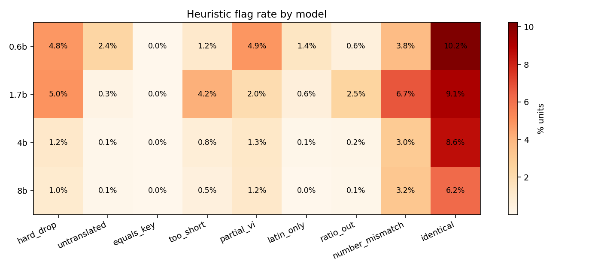
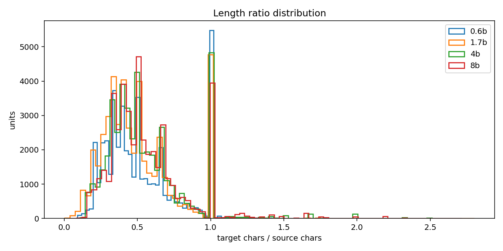
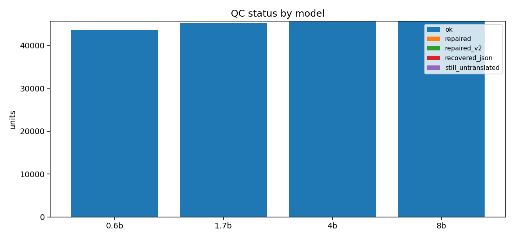
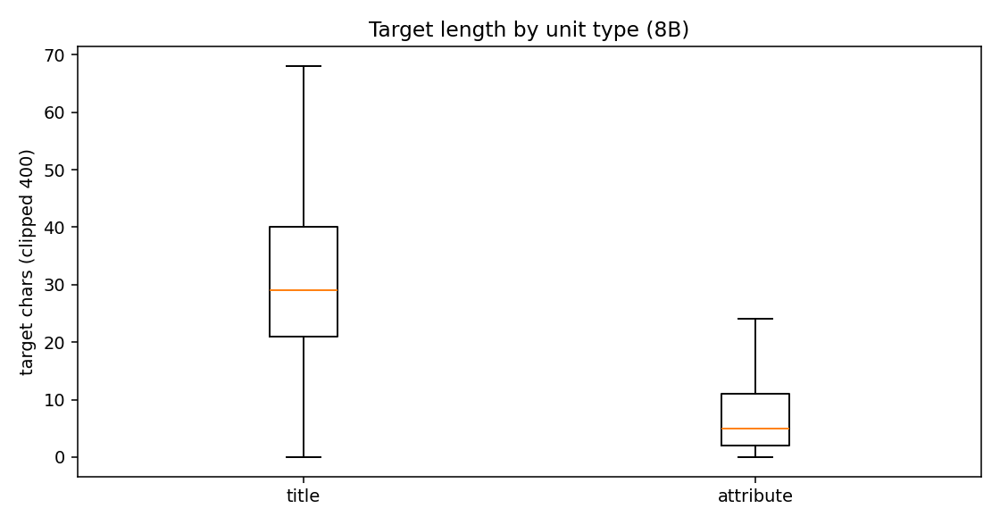

# EDA — Tập song ngữ Tiki (BT unit-level)

## 1. Quy mô

| model | units | train | dev | test | unique source | source→nhiều target | dup cặp |
|---|---|---|---|---|---|---|---|
| 0.6b | 45,709 | 36,434 | 4,824 | 4,451 | 28,620 | 131 | 16,942 |
| 1.7b | 45,709 | 36,434 | 4,824 | 4,451 | 28,620 | 337 | 16,690 |
| 4b | 45,709 | 36,434 | 4,824 | 4,451 | 28,620 | 380 | 16,641 |
| 8b | 45,709 | 36,434 | 4,824 | 4,451 | 28,620 | 427 | 16,567 |

## 2. Độ dài & tỉ lệ

| model | src p50 | src p95 | tgt p50 | tgt p95 | ratio p05 | ratio p50 | ratio p95 |
|---|---|---|---|---|---|---|---|
| 0.6b | 15 | 116 | 8 | 60 | 0.20 | 0.46 | 1.00 |
| 1.7b | 15 | 116 | 8 | 56 | 0.20 | 0.44 | 1.00 |
| 4b | 15 | 116 | 9 | 58 | 0.22 | 0.50 | 1.00 |
| 8b | 15 | 116 | 9 | 59 | 0.25 | 0.50 | 1.00 |

## 3. Cờ heuristic (% units)

| model | hard drop | untranslated | equals key | too short | partial VI | latin only | ratio out | number mismatch | identical |
|---|---|---|---|---|---|---|---|---|---|
| 0.6b | 4.82% | 2.39% | 0.04% | 1.16% | 4.88% | 1.42% | 0.58% | 3.80% | 10.23% |
| 1.7b | 4.95% | 0.31% | 0.03% | 4.15% | 2.04% | 0.63% | 2.52% | 6.73% | 9.12% |
| 4b | 1.24% | 0.07% | 0.03% | 0.76% | 1.28% | 0.10% | 0.19% | 3.01% | 8.56% |
| 8b | 1.03% | 0.05% | 0.01% | 0.54% | 1.23% | 0.02% | 0.12% | 3.24% | 6.23% |

## 4. Đồng thuận giữa model

- cặp so sánh: 45,709
- cả 4 model giống hệt: **14.74%**

| cặp | target giống hệt | cùng có/không chữ Hán |
|---|---|---|
| 0.6b|1.7b | 24.33% | 92.43% |
| 0.6b|4b | 19.23% | 90.58% |
| 0.6b|8b | 19.78% | 90.84% |
| 1.7b|4b | 24.74% | 94.98% |
| 1.7b|8b | 24.70% | 95.30% |
| 4b|8b | 30.98% | 96.41% |

## 5. Sau làm sạch

| model | giữ | loại | % giữ | test đủ | test dùng được | cặp unique (train+dev) | trùng lặp |
|---|---|---|---|---|---|---|---|
| 0.6b | 43,694 | 2,204 | 95.59% | 4,451 | 4,262 | 24,493 | 14,750 |
| 1.7b | 43,629 | 2,262 | 95.45% | 4,451 | 4,269 | 24,894 | 14,284 |
| 4b | 45,192 | 566 | 98.87% | 4,451 | 4,402 | 26,161 | 14,580 |
| 8b | 45,285 | 470 | 99.07% | 4,451 | 4,405 | 26,309 | 14,525 |

## 6. Hình

