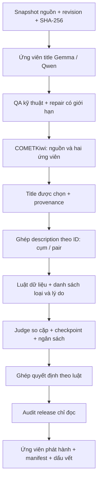

# Kiến trúc xử lý

## Phạm vi

Hệ thống xử lý hai hướng: 1688 zh→vi và Tiki vi→zh. Tách dữ liệu nguồn, ứng viên, điểm đánh giá, lựa chọn, dữ liệu ghép và dấu vết sửa. Không dùng description để tự thay ID/title hoặc mất dòng trong bước ghép.

Sơ đồ mô tả quan hệ nghiệp vụ, không có nghĩa một lệnh tự chạy tất cả bước hoặc tự upload.

## Module và trách nhiệm

| Khu vực | Chịu trách nhiệm | Không được suy ra |
|---|---|---|
| `src/title_translation_pipeline.py` | Ràng buộc snapshot, QA, lấy mẫu và helpers | Runner cũ là model hiện hành cho mọi lượt |
| `src/title_translation_hybrid.py` | Adapter API/local, cache và stage | Cấu hình Qwen3.5 mặc định là bản AWQ đã deploy |
| `src/tiki_translation_pipeline.py` | Hướng Việt→Trung và SQLite cache | Title chỉ có Latin chắc chắn lỗi |
| `scripts/notebooks/` | Rewrite theo phiên bản, bundling, worker riêng | Template bằng với phiên Kaggle đang chạy |
| `src/kaggle_batch_supervisor.py` | Giám sát batch, checkpoint và aggregate progress | GPU hoạt động hoặc RUNNING chứng minh có thêm bản dịch |
| `scripts/comparison/` | Chuẩn bị/chấm COMETKiwi và select strict | Score là xác suất đúng ngữ nghĩa |
| `scripts/merge/` | Ghép theo cấu hình, nghiệm thu và kê khai loại | Mọi dòng bị loại là bản dịch lỗi |
| `scripts/judge/` | Blind comparison, giới hạn token/chi phí, ghép | Tie, blocked, giữ theo luật là model thắng mới |
| `scripts/ft_clean/` | Cờ cứng/mềm, tập giữ/loại, metadata | Split cuối cho mọi mô hình đã được quyết định |
| `scripts/audit/audit_release.py` | Kiểm tra local read-only, checksum và signal | Rà toàn bộ ngữ nghĩa bằng kiểm tra chữ/số |

## Cơ chế bảo toàn kết quả

- Snapshot đầu vào phải gắn revision và checksum; không dùng HEAD tùy ý khi đối chiếu kết quả cũ.
- Cache model, COMET và judge là các đối tượng khác nhau. Chỉ resume với cấu hình, prompt/rubric và checkpoint tương thích.
- Worker repair kiểm soát số attempts và khóa cấu hình. Tổ chức lại code làm thay đổi SHA code; không dùng file đã di chuyển để ghi đè một lượt repair cũ có khóa SHA khác.
- Bản template Colab/Kaggle được giữ để kiểm thử/rebuild, không tự kết nối lại phiên interactive hoặc khởi chạy controller cũ.
- Khi thay chính sách strict→no-floor, phải ghi policy khác. Không đổi điểm hoặc xóa QA để tạo cảm giác dữ liệu sạch.

## Bảng cuối và truy vết

Bảng judged gọn gồm `product_id`, `source`, `category`, `title_zh`, `title_vi`, `description_zh`, `description_vi`, `judge_chon_title`, `judge_chon_description`. Bộ cụm và pair có thể khác description; không sao chép provenance description từ cụm sang pair.

Chi tiết từng key/value, quyết định không áp dụng, nguồn chưa rõ và sửa bổ sung nằm trong bảng truy vết riêng. Mã lịch sử xây dựng/chỉnh schema được giữ trong `archive/judged_release_history/`; chúng cần private artifacts và không phải API công khai ổn định.
