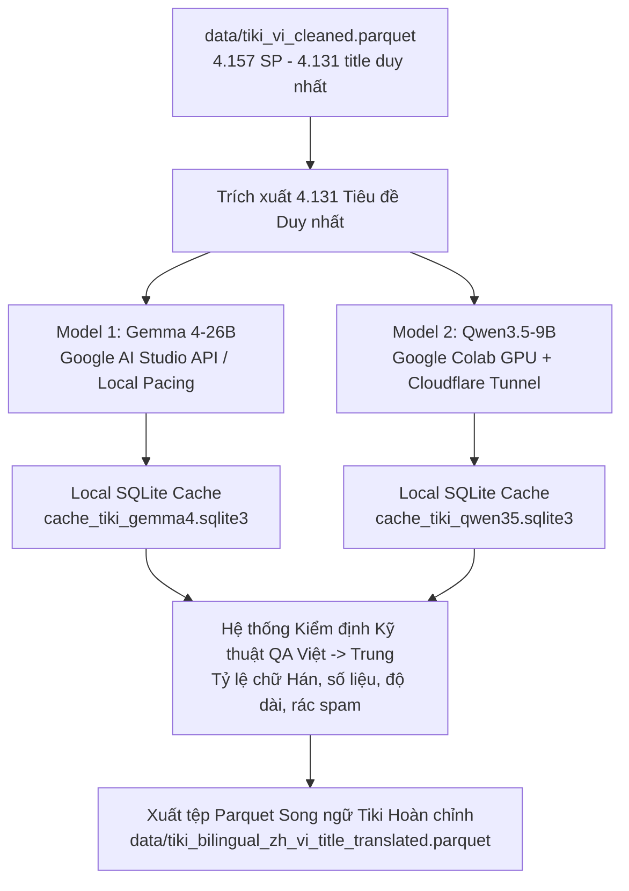

# Hướng dẫn Pipeline Dịch Tiêu Đề Tiki (Việt -> Trung) bằng Dual-Model (Gemma 4 & Qwen3.5-9B)

## Chạy bộ Tiki Cado mới bằng Gemma

Lượt Gemma hiện tại dùng đúng `data/cleaned/tiki/tiki_vi_cado.parquet` trên HF,
revision `51540c9e189a6747e768cec08c25c0d4a68776da`, SHA-256
`26e027f714764d16cdd76ae711892b869931fa7302fff5bc75b64a43415e4297`.
Bộ này có 13.200 dòng và 13.102 tiêu đề `title_vi_cleaned` duy nhất; các số
4.157/4.131 phía dưới thuộc bộ Tiki cũ.

Worker `run_tiki_gemma_supervised.py` dùng lại prompt, QA và cache của
`tiki_translation_pipeline.py`. Thư mục lượt chạy là
`title_translation_tiki_gemma4_vi_zh_v1`, tách khỏi cache Tiki cũ. Worker chạy
smoke 10 mẫu, pilot 50 mẫu, rồi full khi completion >=99% và QA kỹ thuật >=90%.
Lựa chọn `--defer-full-quality-review` cho phép tiếp tục full với cờ QA như
lượt 1688; không hạ ngưỡng QA hay đổi cờ, và báo cáo cuối vẫn ghi chất lượng
chưa đạt nếu còn lỗi. Lượt Tiki hiện tại dùng lựa chọn này sau preflight.
Bản dịch cắt cụt không được tính hoàn thành. Hết quota hoặc lỗi cấu hình sẽ
dừng với trạng thái rõ ràng; chạy lại cùng cấu hình sẽ tiếp tục từ SQLite.

Xem heartbeat, tiến độ và xác minh PID còn sống, không mở title/bản dịch:

```powershell
.\.venv-title-translation\Scripts\python.exe report_tiki_gemma_status.py
```

Heartbeat được ghi mỗi 30 giây vào `tiki_live_status.json`. Thời điểm tiến độ
cuối được theo dõi riêng; `running` không tự chứng minh số mẫu đang tăng.
Trạng thái `heartbeat_stale`, `suspected_stall`, `paused_quota_daily`,
`paused_api_errors` và `quality_gate_failed` cần được xem xét trước khi resume.
Kết thúc full sẽ xuất Parquet Gemma và báo cáo QA trong thư mục lượt chạy.

Tài liệu này hướng dẫn chi tiết cách vận hành pipeline dịch tiêu đề thương mại điện tử từ **Tiếng Việt sang Tiếng Trung Giản thể (zh-CN)** cho bộ dữ liệu Tiki (`data/tiki_vi_cleaned.parquet`), kế thừa và đảo chiều tiêu chuẩn nghiên cứu từ báo cáo đề án song ngữ.

---

## 1. Tổng quan Kiến trúc



### Cơ chế Dual-Model
- **Gemma 4 (`gemma-4-26b-a4b-it`)**: Chạy từ máy Local gọi Google AI Studio Gemini API qua thư viện `google-genai`. Tự động pacing (nghỉ 4-5s giữa các request để bảo vệ quota free tier).
- **Qwen3.5 (`Qwen/Qwen3.5-9B`)**: Chạy trên Google Colab GPU (T4 16GB VRAM) với lượng tử hóa 8-bit qua BitsAndBytes. Mở một **Cloudflare Tunnel miễn phí 100%** cấp public URL. Agent tại máy local gửi batch request lên Colab và nhận bản dịch về.

---

## 2. Cách Điều Khiển Qwen Trên Google Colab Trực Tiếp Từ Agent

### Bước 1: Mở Notebook trên Google Colab
1. Mở file [colab_qwen35_server.ipynb](file:///d:/download/NCKH/eda_ecom/colab_qwen35_server.ipynb) trên [Google Colab](https://colab.research.google.com/).
2. Chọn **Runtime → Change runtime type → GPU** (chọn T4 GPU).
3. Chọn **Runtime → Run all**.
4. Chờ cell cuối khởi động, bạn sẽ thấy link công khai in ra:
   ```text
   ============================================================
   🔥 ĐÃ CÓ URL KẾT NỐI CHO AGENT:
   👉 https://random-subdomain.trycloudflare.com
   ============================================================
   ```

### Bước 2: Agent điều khiển dịch trực tiếp từ máy tính
Bạn chỉ cần copy URL đó và đưa cho Agent hoặc chạy lệnh:

```powershell
# Xem thử nghiệm 10 tiêu đề (Smoke test)
.\.venv-title-translation\Scripts\python.exe run_tiki_translation.py --model qwen35 --mode smoke --endpoint https://random-subdomain.trycloudflare.com

# Dịch 50 tiêu đề để kiểm định (Pilot test)
.\.venv-title-translation\Scripts\python.exe run_tiki_translation.py --model qwen35 --mode pilot --endpoint https://random-subdomain.trycloudflare.com

# Dịch toàn bộ 4.131 tiêu đề (Full test)
.\.venv-title-translation\Scripts\python.exe run_tiki_translation.py --model qwen35 --mode full --endpoint https://random-subdomain.trycloudflare.com
```

> **Ưu điểm vượt trội**:
> Toàn bộ dữ liệu dịch, trạng thái QA và checkpoint SQLite được ghi trực tiếp trên ổ cứng máy bạn (`data/cache_tiki_qwen35.sqlite3`). Nếu Colab bị ngắt kết nối (timeout/disconnect), bạn chỉ cần bật lại cell Colab lấy link mới rồi chạy tiếp; không bao giờ bị mất dữ liệu!

---

## 3. Cách Chạy Dịch Gemma 4 Local Gọi Google AI Studio API

Đảm bảo bạn đã có `GEMINI_API_KEY` (được cấu hình qua biến môi trường hoặc file `.env`):

```powershell
# Smoke test (10 tiêu đề)
.\.venv-title-translation\Scripts\python.exe run_tiki_translation.py --model gemma4 --mode smoke

# Pilot test (50 tiêu đề)
.\.venv-title-translation\Scripts\python.exe run_tiki_translation.py --model gemma4 --mode pilot

# Full run (4.131 tiêu đề)
.\.venv-title-translation\Scripts\python.exe run_tiki_translation.py --model gemma4 --mode full
```

---

## 4. Xem Tiến Độ & Xuất File Parquet Hoàn Chỉnh

### Xem tiến độ hiện tại:
```powershell
.\.venv-title-translation\Scripts\python.exe run_tiki_translation.py --mode status
```

### Xuất tệp Parquet song ngữ tích hợp QA:
```powershell
.\.venv-title-translation\Scripts\python.exe run_tiki_translation.py --mode export
```
File đầu ra sẽ được lưu tại: `data/tiki_bilingual_zh_vi_title_translated.parquet` bao gồm:
- Toàn bộ 41 cột gốc của Tiki (giữ nguyên `product_id`, specs, categories, giá...).
- `title_zh_gemma4` & cờ QA của Gemma 4.
- `title_zh_qwen35` & cờ QA của Qwen3.5-9B.
- `title_zh`: Tiêu đề tiếng Trung được chốt sau khi đối soát QA giữa hai mô hình.
