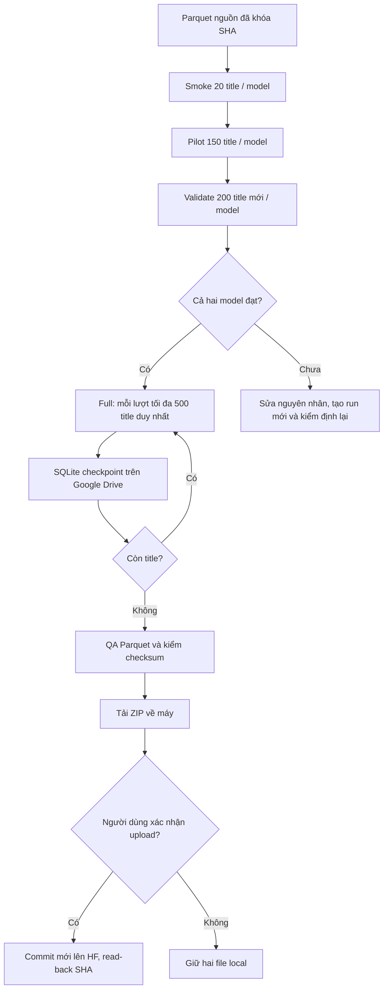

# Pipeline dịch title Cado — Gemma API + Qwen local

> **Luồng Qwen chạy riêng và dịch full trước, QA sau:** dùng [hướng dẫn Qwen Colab](./QWEN_COLAB_GUIDE.md), notebook [title_translation_qwen35_colab.ipynb](./title_translation_qwen35_colab.ipynb) và bundle [title_translation_qwen35_colab_bundle.zip](./title_translation_qwen35_colab_bundle.zip). Notebook riêng này không dùng checkpoint Gemma và không áp dụng các quality gate từng mẫu trong quy trình phối hợp bên dưới.

## Phương án chạy đã chọn

- **Gemma 4-26B-A4B-it:** gọi Google AI Studio Gemini API bằng model ID `gemma-4-26b-a4b-it`. Free tier hiện ghi giá input/output miễn phí cho Gemma 4, nhưng quota theo project (RPM/TPM/RPD) thay đổi và xem trong AI Studio; 15.863 title có thể cần chạy nhiều phiên/ngày. Free-tier data có thể được Google dùng để cải thiện sản phẩm, vì vậy chỉ gửi `title_zh`, không gửi product ID hay thông tin nhạy cảm. [Hướng dẫn Gemma API](https://ai.google.dev/gemma/docs/core/gemma_on_gemini_api), [giá và điều khoản dữ liệu](https://ai.google.dev/gemini-api/docs/pricing), [rate limits](https://ai.google.dev/gemini-api/docs/rate-limits).
- **Qwen3.5-9B:** tải trọng số công khai từ Hugging Face và chạy local trên GPU Colab/Kaggle bằng Transformers, lớp text-only `Qwen3_5ForCausalLM`, lượng tử 8-bit. Không gọi HF Inference Providers và không dùng HF inference credits. Notebook yêu cầu CUDA GPU có ít nhất 14 GiB VRAM; một T4 16 GB là mục tiêu phù hợp, GPU thứ hai không bắt buộc. [Tài liệu Qwen3.5 Transformers](https://huggingface.co/docs/transformers/model_doc/qwen3_5), [model card](https://huggingface.co/Qwen/Qwen3.5-9B).
- **Gemma chạy được trên laptop không có GPU** vì máy chỉ gửi title lên Google AI Studio API. Qwen chạy riêng trên GPU Colab; weights Qwen được tải vào runtime cloud, không phải ổ cứng laptop.
- **Upload HF vẫn tách biệt:** pipeline không tự upload. Sau khi hai Parquet hoàn chỉnh, tải ZIP run về máy và chạy lệnh upload riêng; chỉ khi đó mới nhập HF write token.

> Google API key là credential khác HF token. Tạo `GEMINI_API_KEY` trong Colab Secrets và không dán/in khóa trong notebook. HF read token không bắt buộc cho model Qwen public; HF write token chỉ cần ở bước publish sau này.

## Nguồn và dữ liệu đầu ra

- Nguồn: `ntquang0410/zh-vie_ecom`, `data/cleaned/bilingual_zh_vi_cado.parquet`, revision `e098c4dbd40a5ab1b4f2670f7d4b028aa4e09f88`.
- SHA-256: `d5095f50f09d539140822b5bd41d2fba517a199ea5ba4f0204ccf50ac2cd0559`.
- 16.348 dòng, 15.863 title `title_zh` duy nhất, 9 ngành hàng. Các title trùng dịch một lần rồi ánh xạ lại đủ sản phẩm.
- Dùng `title_zh` làm nguồn; giữ nguyên cột title Việt đang có làm dữ liệu đối chiếu. Không chạy lại bước cleaning, không dịch description, không chia train/dev/test và không fine-tune.
- Hai output riêng: `bilingual_zh_vi_cado_title_gemma4.parquet` và `bilingual_zh_vi_cado_title_qwen35.parquet`. Mỗi file phải đủ 16.348 dòng, product ID/thứ tự/cột gốc giữ nguyên; thêm ứng viên, QA, revision/model/config và `semantic_verified=False`.

## Sơ đồ



## Các bước chạy trên Colab

1. Mở [title_translation_free_hybrid.ipynb](./title_translation_free_hybrid.ipynb), chọn runtime GPU (T4 hoặc GPU có VRAM ≥14 GiB), bật Internet.
2. Tải [`title_translation_free_hybrid_bundle.zip`](./title_translation_free_hybrid_bundle.zip) từ project. Chạy cell mount Drive rồi upload ZIP khi notebook hỏi. ZIP chứa Parquet nguồn và hai file Python cần thiết, không chứa credential.
3. Trong Colab Secrets, thêm tên `GEMINI_API_KEY`, dán Google AI Studio API key vào đó và bật quyền notebook đọc secret. Không gửi key vào chat/Codex, không đặt trong cell.
4. Chạy các cell cài thư viện, kiểm SHA nguồn và nhập pipeline. Chọn `MODEL_KEY`/`RUN_MODE`; thứ tự mỗi model là `smoke` → `pilot` → `validate` (chỉ tiến tiếp nếu stage trước đạt).
5. Khi chạy Qwen trên Colab sau khi đã dùng Gemma local, chạy lệnh `gemma-pack` ở dưới, tải ZIP checkpoint lên Drive. Nếu Drive chưa có run folder, cell nhập checkpoint sẽ hỏi upload ZIP; sau đó chọn `MODEL_KEY='qwen35'`. Hai model có thể chạy full độc lập sau khi từng model vượt validate. Mỗi lần full xử lý tối đa 500 title duy nhất; SQLite/state nằm tại `MyDrive/title_translation_cado_free_hybrid_run_v2`.
6. Nếu Gemma hết quota/rate limit, pipeline giữ cache và trả trạng thái checkpoint; đợi quota hồi rồi chạy lại đúng model/stage, không xóa thư mục run. RPD reset theo múi giờ Pacific; quota hiện hành xem tại AI Studio. Không đổi model/prompt giữa các stage đã khóa.
7. Khi cả hai model hoàn tất, chạy cell đóng gói, tải `title_translation_cado_free_hybrid_run_v2.zip` từ Drive về máy. Giải nén vào thư mục project để tạo `title_translation_cado_free_hybrid_run_v2`, sau đó chạy:

   ```powershell
   .\run_title_translation_local.ps1 upload
   ```

   Lệnh kiểm checksum/rows/source/cache, rồi mới hỏi HF write token bằng prompt ẩn và yêu cầu gõ `UPLOAD`. Nó tạo commit mới dưới `data/title_translations/<run-id>/`; không ghi đè Parquet nguồn.

Notebook cố ý chạy **một model/stage mỗi lượt** để quota, thời gian Colab và checkpoint dễ kiểm soát. Khi full, mỗi lần chạy chỉ xử lý 500 title; có thể dừng giữa chừng và resume từ cache. Đừng chạy song song hai notebook lên cùng một run folder.

## Chạy Gemma trên máy local, Qwen trên Colab

Trong PowerShell mở tại thư mục project, lưu một key Google AI Studio **mới** một lần bằng lệnh dưới đây. Key được nhập ẩn và lưu mã hóa bằng Windows DPAPI cho tài khoản Windows hiện tại; key không nằm trong source, `.env`, checkpoint hay Git. Sau đó mỗi lệnh tự lấy key cục bộ và chỉ hỏi xác nhận chạy.

```powershell
Set-Location -LiteralPath 'D:\download\NCKH\eda_ecom'
.\set_gemini_key.ps1
.\run_title_translation_local.ps1 gemma-smoke
```

Key đã lưu chỉ giải mã vào bộ nhớ trong lúc chạy. Để xóa key cục bộ:

```powershell
.\set_gemini_key.ps1 -Remove
```

Nếu chưa lưu key, runner vẫn cho nhập bằng prompt ẩn. Chạy lần lượt các stage; mỗi lệnh yêu cầu xác nhận trước request:

```powershell
.\run_title_translation_local.ps1 gemma-pilot
.\run_title_translation_local.ps1 gemma-validate
```

Chỉ khi validation đạt mới chạy full (tối đa 1.000 title mỗi lượt; chạy lại để resume). Full có thể tiêu thụ quota đáng kể:

```powershell
.\run_title_translation_local.ps1 gemma-full
```

Để chuyển SQLite, run state và Parquet Gemma sang Google Drive cho Qwen tiếp tục trong cùng run:

```powershell
.\run_title_translation_local.ps1 gemma-pack
```

Tải ZIP vừa tạo lên Colab khi notebook hỏi checkpoint. Không đưa API key vào ZIP. Không chạy Gemma và Qwen song song trên cùng một thư mục checkpoint; đợi một lệnh ghi xong rồi mới đóng gói/chuyển.

## Tiêu chí và giới hạn kiểm định

- Smoke: ít nhất 99% output hoàn chỉnh.
- Pilot/validate: ít nhất 99% tác vụ/model hoàn chỉnh và ít nhất 95% mẫu đại diện qua QA kỹ thuật; báo riêng mẫu khó.
- Full kiểm tra từng cửa sổ 200 title; dừng nếu incomplete >1% hoặc lỗi QA kỹ thuật >5%.
- Mọi bản dịch được đánh dấu `semantic_verified=False`: kiểm tự động không chứng minh đúng nghĩa. Các điểm chrF/BGE (nếu có) chỉ giúp sàng bất đồng.
- Qwen model download cần internet, dung lượng ổ đĩa runtime lớn và VRAM phù hợp. Nếu runtime Colab reset, checkpoint ở Drive vẫn giữ; model weights có thể phải tải lại.
- Google API free tier có quota hữu hạn. Mỗi unique title cần ít nhất một request Gemma; không thể đảm bảo hoàn tất cả 15.863 title trong một ngày hoặc trong một phiên free. Quota/model access thay đổi theo tài khoản/project.

## Kiểm tra offline

```powershell
python -m py_compile title_translation_hybrid.py title_translation_pipeline.py run_title_translation_local.py
python -m unittest discover -s tests -p "test_title_translation_hybrid.py" -v
python -m unittest discover -s tests -p "test_title_translation_runner.py" -v
```

Test offline giả lập API/model adapter và kiểm cache/QA/export/upload; không thay cho smoke thật trên Colab, không xác nhận quyền Google key, quota, tải Qwen hay độ đúng ngữ nghĩa.
