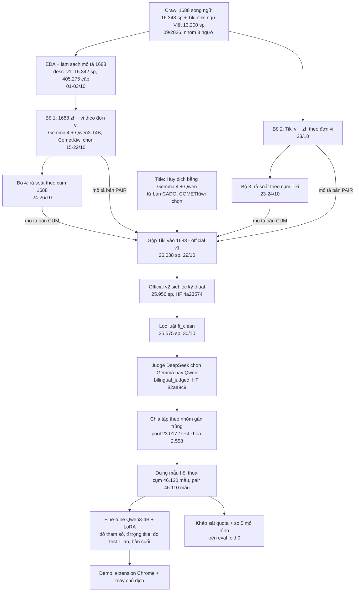

# Pipeline end-to-end của hai bộ song ngữ cho LLM (bản cụm và bản pair)

Viết ngày 16/11/2026 cho Quang (và AI bên Quang) để nắm toàn bộ những gì hướng Nhật Anh đã làm, từ dữ liệu crawl tới mô hình và demo hiện tại. Bộ tài liệu này **chỉ mô tả**, không kèm hướng dẫn chạy lại.

Nhãn dùng chung: **[ĐO]** số đo trên dữ liệu thật; **[ƯỚC]** ước tính; **[CHƯA KIỂM]** chưa xác minh. Số viết kiểu Việt (dấu chấm ngăn nghìn), trừ trong bảng kết quả mô hình.

## 1. Hai bộ dữ liệu là gì

| | Bản **cụm** (`context`) | Bản **pair** (`independent` / `pair`) |
|---|---|---|
| Sản phẩm | 25.575 (cùng tập, cùng thứ tự với pair) | 25.575 |
| Title | giống hệt bản pair | giống hệt bản cụm |
| Mô tả (thực chất là **danh sách thuộc tính** `tên: giá trị`) | các thuộc tính nối bằng `"; "` trên một dòng | mỗi thuộc tính một dòng (`\n`) |
| Cách dịch mô tả | mô hình **thấy cả title và toàn bộ danh sách thuộc tính** của sản phẩm (rà soát theo cụm, có ngữ cảnh) | mỗi **tên** và mỗi **giá trị** dịch riêng như một đơn vị, **không ngữ cảnh** |
| Sinh ra từ | bộ song ngữ 3 (Tiki) và 4 (1688) | bộ song ngữ 1 (1688) và 2 (Tiki) |
| Bản cuối trên HF | `ntquang0410/zh-vie_ecom`, `data/LLM/bilingual_judged/bo_cum_chon_deepseek.parquet`, commit `82aa9c9` | `.../bo_pair_chon_deepseek.parquet`, cùng commit |

- **Hai nguồn, mỗi nguồn một hướng gốc.** 1688 là tiếng Trung gốc, bản Việt do LLM dịch, nên hướng gốc là **zh→vi** (14.837 sản phẩm). Tiki là tiếng Việt gốc, bản Trung do LLM dịch, nên hướng gốc là **vi→zh** (10.738 sản phẩm).
- **Phía đích luôn là bản dịch máy:** Gemma 4 hoặc Qwen3-14B, chọn bằng Judge DeepSeek. Chưa có người song ngữ kiểm toàn bộ. Mọi điểm chrF/BLEU về sau chỉ đo **độ giống bản dịch máy dùng làm tham chiếu**.
- **Không có văn xuôi.** Phần mô tả chi tiết của 1688 là ảnh, nên dữ liệu chỉ gồm title và bảng thuộc tính.
- **Hai bản khác nhau ở đâu.** Phần mô tả khác nhau ở khoảng 4,8% mảnh (bàn giao 07/11). Khi dịch đúng dạng và dùng đúng adapter của dạng đó, chất lượng hai bản ngang nhau (thử chéo, file 09 mục 6).

## 2. Sơ đồ

## 3. Phễu số sản phẩm

| Mốc | 1688 (zh→vi) | Tiki (vi→zh) | Tổng | Nguồn số |
|---|---|---|---|---|
| Snapshot crawl | 16.348 | 13.200 | 29.548 | `data/snapshot/SNAPSHOT.md`, kế hoạch gộp mục 3 |
| Có mô tả dùng được | 16.342 | 13.187 | 29.529 | desc_v1 README; kế hoạch gộp R0 |
| Official v1 (Huy gộp, 29/10) | 14.996 | 11.042 | 26.038 | `docs/gop_tiki_1688/KE_HOACH_GOP_TIKI_VAO_1688.md` |
| Official v2 strict (HF `4a23574`, 29/10) | 14.928 | 11.028 | 25.956 | WALKTHROUGH Trả lời 600 |
| Sau lọc luật `ft_clean` | 14.837 | 10.738 | 25.575 | `data/processed/ft_clean/pheu_buoc0_4.json` |
| Sau Judge (bản phát hành) | 14.837 | 10.738 | 25.575 | `data/processed/bo_chon_hf/manifest.json` |
| Pool (5 fold) | 13.352 | 9.665 | 23.017 | `chia_tap_v2` |
| Test khóa (10%) | 1.485 | 1.073 | 2.558 | `chia_tap_v2` |

## 4. Mục lục bộ tài liệu

| File | Giai đoạn | Thời gian |
|---|---|---|
| [01_thu_thap_crawl.md](01_thu_thap_crawl.md) | Crawl 1688 và Tiki, snapshot | 09/2026 – 01/10 |
| [02_eda_va_lam_sach_mo_ta.md](02_eda_va_lam_sach_mo_ta.md) | EDA title/mô tả, pipeline làm sạch mô tả, bản `desc_v1` | 28/09 – 03/10 |
| [03_dich_theo_don_vi_bo_1_2.md](03_dich_theo_don_vi_bo_1_2.md) | Chọn mô hình dịch; bộ 1 (1688) và bộ 2 (Tiki): nguồn của **bản pair** | 04 – 23/10 |
| [04_ra_soat_theo_cum_bo_3_4.md](04_ra_soat_theo_cum_bo_3_4.md) | Bộ 3 (Tiki) và bộ 4 (1688): nguồn của **bản cụm** | 23 – 26/10 |
| [05_gop_tiki_vao_1688_official.md](05_gop_tiki_vao_1688_official.md) | Title (Huy), gộp hai nguồn, official v1 và v2 | 26 – 29/10 |
| [06_loc_luat_ft_clean.md](06_loc_luat_ft_clean.md) | Lọc luật trước fine-tune | 30/10 |
| [07_judge_deepseek.md](07_judge_deepseek.md) | Judge chọn bản Gemma hay Qwen, bộ `bilingual_judged` | 29/10 – 03/11 |
| [08_chia_tap_va_dung_mau.md](08_chia_tap_va_dung_mau.md) | Chia tập, khóa test, cờ title, mẫu huấn luyện, Dataset Kaggle | 04 – 12/11 |
| [09_fine_tune_va_danh_gia.md](09_fine_tune_va_danh_gia.md) | Fine-tune Qwen3-4B, tỉ trọng title, test, bản cuối, quota, năm mô hình, thử chéo | 05 – 14/11 |
| [10_demo_hien_trang_va_gioi_han.md](10_demo_hien_trang_va_gioi_han.md) | Demo, 8B chưa chạy được, việc còn mở, giới hạn phải ghi | 13 – 16/11 |

Tài liệu liên quan đã có trong repo:
- [`docs/ket_qua_kaggle/INDEX.md`](../ket_qua_kaggle/INDEX.md): 36 phiên Kaggle và phiên chạy trên máy, mỗi phiên một file. Số trong đó sinh tự động từ JSON gốc.
- [`docs/TONG_HOP_KET_QUA_NHAT_ANH.md`](../TONG_HOP_KET_QUA_NHAT_ANH.md): bảng kết quả gom một chỗ.
- [`docs/sessions/`](../sessions/): toàn bộ hội thoại Nhật Anh và Claude về đề tài này (JSON, đã lọc và che bí mật).

## 5. Ai làm gì (theo nhật ký)

| Việc | Người |
|---|---|
| Crawler, crawl 3 máy song song | cả nhóm (`worker_quang`, `worker_nhat_anh`, `worker_huy`) |
| EDA, làm sạch mô tả, bộ song ngữ 1–4 (phía **mô tả**) | Nhật Anh (với Claude) |
| Dịch **title** bằng hai mô hình (Gemma 4 + Qwen, chọn bằng COMETKiwi), mã ở nhánh GitHub `giahuy` | Huy |
| Kế hoạch và quy tắc gộp Tiki vào 1688 | Nhật Anh soạn; Huy duyệt quy tắc title, chạy script gộp, đẩy HF |
| Bản official v2 strict (`4a23574`, siết lọc kỹ thuật, bớt 82 sản phẩm) | Huy (HF đẩy chung qua tài khoản `ntquang0410`) |
| `ft_clean`, thiết kế và mã Judge, thí điểm Judge | Nhật Anh |
| Chạy Judge đầy đủ, đưa `bilingual_judged` lên HF | Huy (Nhật Anh xác nhận 16/11) |
| Chia tập, fine-tune, khảo sát, năm mô hình, demo | Nhật Anh (với Claude), Kaggle tài khoản `trinhnhatanh` và `honghuynanh` |

## 6. Thuật ngữ

- **Đơn vị** (bộ 1, 2): một tên thuộc tính hoặc một giá trị *khác nhau*, dịch một lần rồi dùng lại cho mọi cặp chứa nó.
- **Cặp**: một dòng `tên: giá trị` của một sản phẩm.
- **Mảnh** (Judge): bản cụm tính một cặp tên–giá trị là một mảnh; bản pair tính tên và giá trị (không rỗng) riêng.
- **Pool**: phần dữ liệu được dùng để huấn luyện và dò, chia 5 fold theo nhóm sản phẩm.
- **Test khóa**: 10% sản phẩm tách ra từ đầu, chỉ đo **một lần** (07/11). Không ai mở để xem ví dụ.
- **Chính** (khi so mô hình): 0,10 × chrF title + 0,90 × chrF mô tả, hướng zh→vi. **Macro**: trung bình đều hai hướng.
