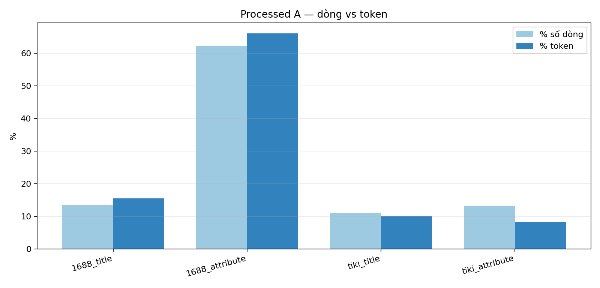
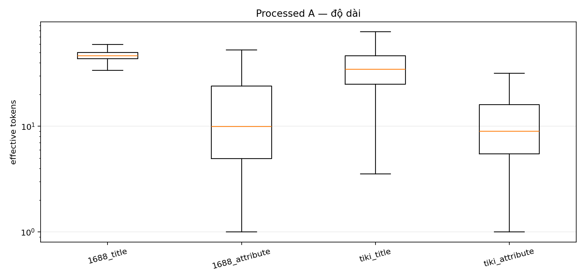
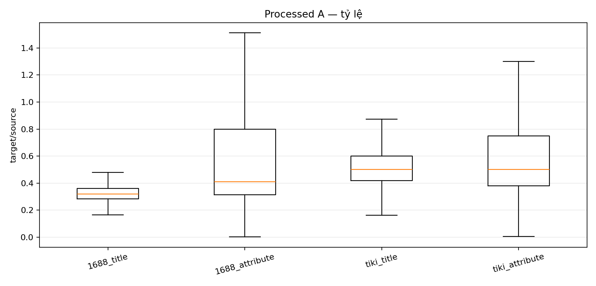
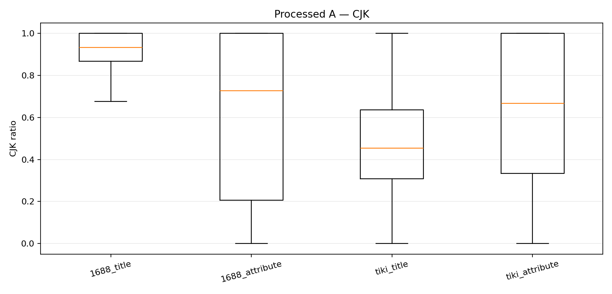
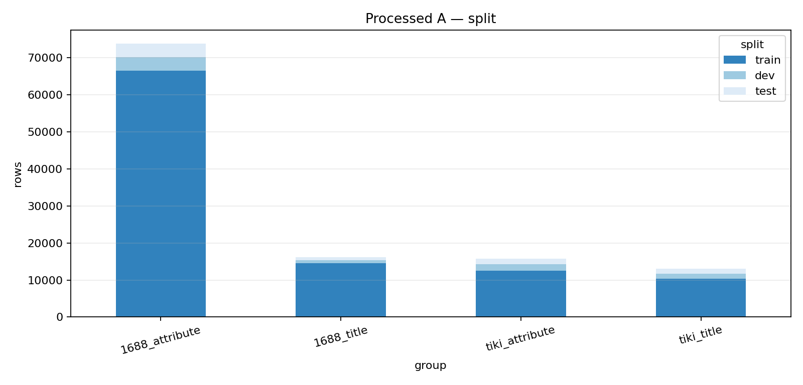
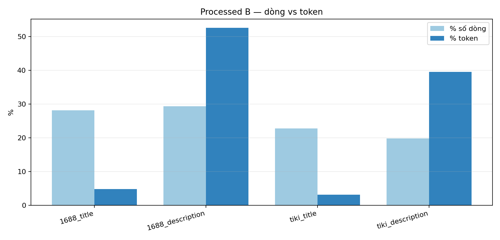
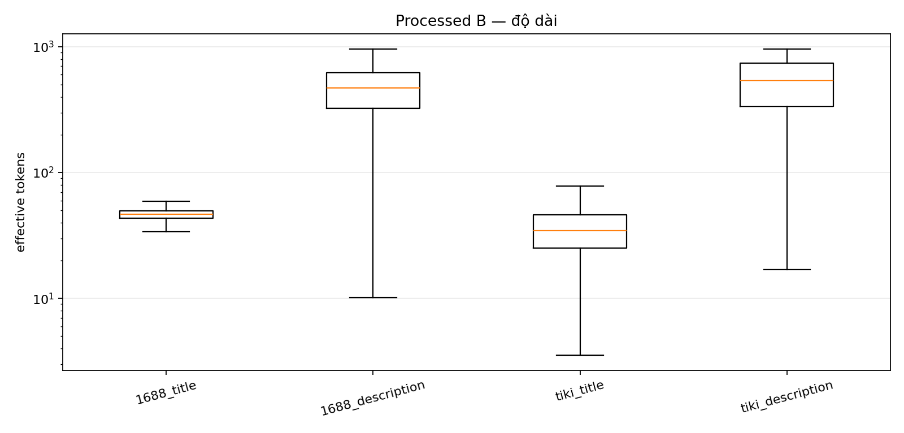
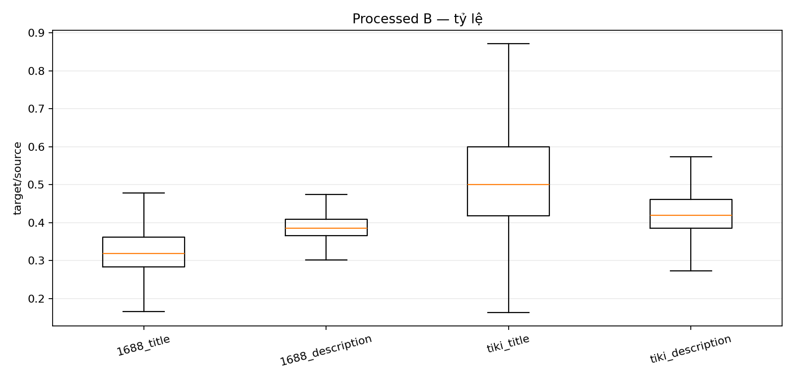
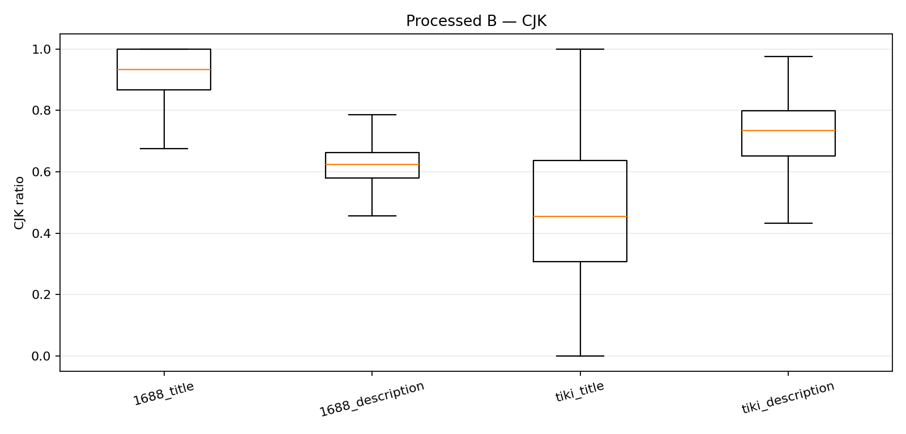
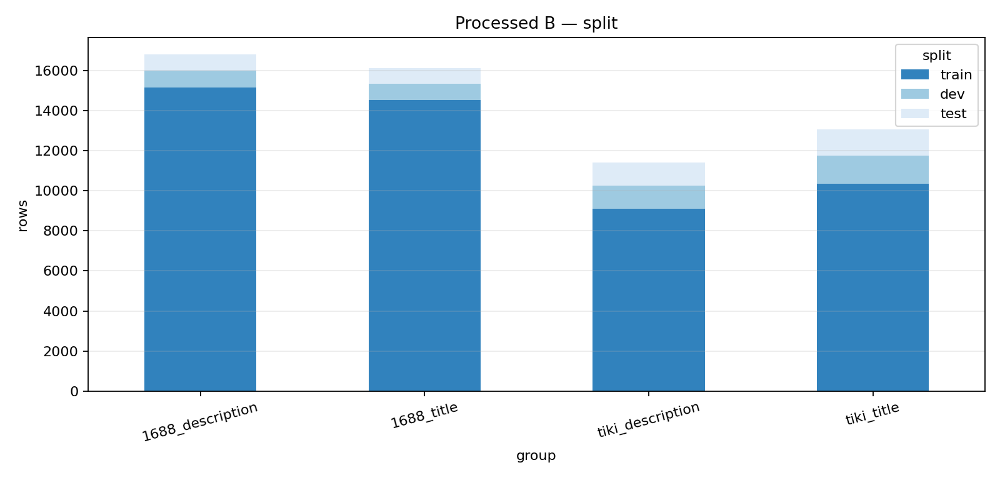

# EDA sau Processing — A/B

**Ngày:** 2026-11-07  
**Input:** `data/cleaned/processed_A/units.parquet`, `processed_B/units.parquet`.

## 1. Tóm tắt processing

| bộ | raw rows | empty dropped | dedup removed | rows full | rows units | chunked parents | token (M) |
|---|---:|---:|---:|---:|---:|---:|---:|
| A | 118,477 | 0 | 0 | 118,732 | 118,732 | 127 | 4.842 |
| B | 59,209 | 1,532 | 485 | 57,999 | 57,406 | 626 | 15.71 |

- A: giữ toàn bộ dòng người/BT đã qua gate; chunk 127 parent >1.280 token.
- B: bỏ 1.532 target rỗng, dedup 485 cặp, chunk 626 parent; Tiki description raw 4B được QC riêng.

## 2. A sau processing

| group | rows | token % | median token | empty | CJK mean |
|---|---:|---:|---:|---:|---:|
| 1688_title | 16,133 | 15.5% | 46.5 | 0 | - |
| 1688_attribute | 73,815 | 66.1% | 9.9 | 0 | - |
| tiki_title | 13,057 | 10.1% | 34.6 | 0 | - |
| tiki_attribute | 15,727 | 8.3% | 9.0 | 0 | - |

Split: `{'train': 103883, 'dev': 7536, 'test': 7313}`. Eval A: **1,200** dòng.











### Nhận xét A

- `1688_attribute` vẫn ~66% token; title 1688 ~15,5%; Tiki ~18%.
- Tất cả dòng A được giữ (`qc_ok = rows`), không bị lọc bởi CJK/ratio vì đây là dữ liệu người/BT đã gate.
- Chunk 127 parent làm tăng nhẹ số dòng; token tăng nhẹ do cách pack chunk.
- A sẵn sàng cho quota sampling; không còn exact duplicate.

## 3. B sau processing

| group | rows | token % | median token | empty | CJK mean |
|---|---:|---:|---:|---:|---:|
| 1688_title | 16,133 | 4.8% | 46.5 | 0 | - |
| 1688_description | 16,819 | 52.6% | 472.5 | 0 | - |
| tiki_title | 13,057 | 3.1% | 34.6 | 0 | - |
| tiki_description | 11,397 | 39.5% | 535.7 | 0 | - |

Split: `{'train': 49166, 'dev': 4169, 'test': 4071}`. Eval B: **900** dòng.











### Nhận xét B

- Description vẫn ~92% token; title ~8%.
- `tiki_description` còn 11.397 dòng sau khi bỏ 1.532 target rỗng và QC raw 4B.
- 626 parent description >1.280 token được chunk; đây là lý do rows units > rows full.
- Boilerplate Tiki đã được strip khỏi source/target trước khi tính lại token.
- B vẫn description-heavy; `balanced`/`title_heavy` sẽ giảm desc mạnh, `desc_heavy` gần natural.

## 4. Dùng cho survey

```text
A survey: data/cleaned/processed_A/units.parquet
B survey: data/cleaned/processed_B/units.parquet
eval A/B giữ nguyên
quota sampling: tools/quota_sampling.py
budget 4M, 500 step
```