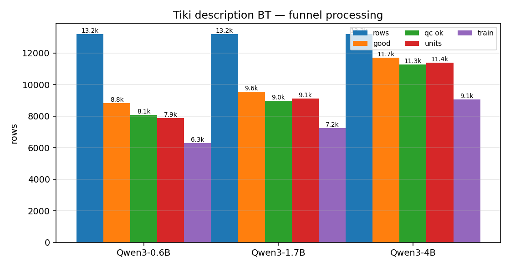
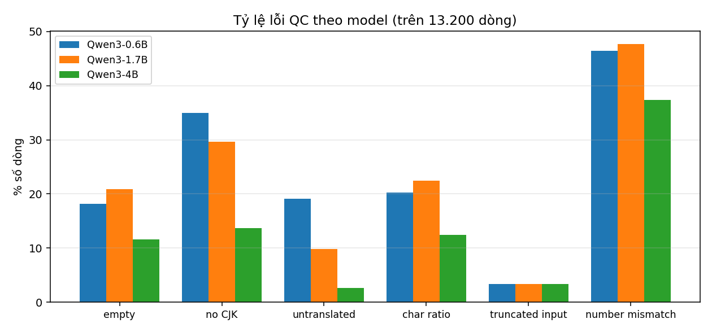
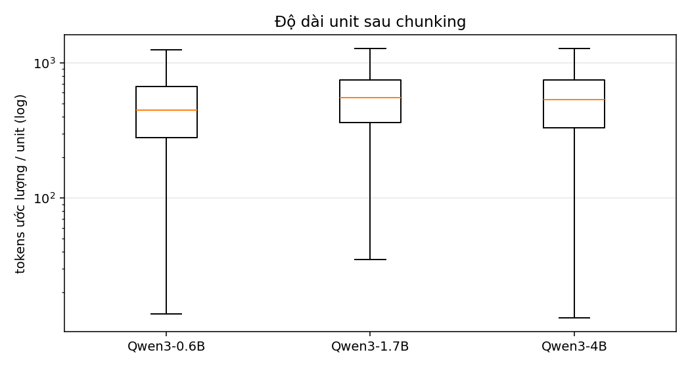

# Tiki description BT — processing 4B

**Ngày:** 2026-11-08  
**Input:** `predictions.parquet` 13.200 dòng của kernel `nadsa091/tiki-description-bt-4b-8b`  
**Script:** `tools/process_bt_desc.py`

## 1. Funnel processing

| model | rows | good | QC ok | QC ok % | dedup bỏ | units | train | token (M) |
|---|---:|---:|---:|---:|---:|---:|---:|---:|
| qwen3-0.6b | 13,200 | 8,823 | 8,091 | 61.3% | 729 | 7,868 | 6,292 | 3.881 |
| qwen3-1.7b | 13,200 | 9,550 | 8,984 | 68.1% | 714 | 9,125 | 7,238 | 5.259 |
| qwen3-4b | 13,200 | 11,712 | 11,276 | 85.4% | 701 | 11,404 | 9,052 | 6.363 |



## 2. Lỗi QC

| model | empty | no CJK | untranslated | char ratio | truncated | number mismatch |
|---|---:|---:|---:|---:|---:|---:|
| qwen3-0.6b | 2,397 | 4,617 | 2,524 | 2,673 | 444 | 6,137 |
| qwen3-1.7b | 2,752 | 3,913 | 1,303 | 2,961 | 444 | 6,295 |
| qwen3-4b | 1,532 | 1,801 | 342 | 1,636 | 444 | 4,939 |



Nhận xét:

- 4B có QC pass cao nhất: **85,4%** (11.276/13.200), so với 68,1% của 1.7B và 61,3% của 0.6B.
- Lỗi `empty` của 4B là 1.532 dòng, thấp hơn nhiều so với 2.752 dòng của 1.7B; đây là lý do chính kéo QC lên.
- `input_truncated` giữ nguyên 444 dòng ở cả 3 model vì cùng nguồn description dài; các dòng này bị loại khỏi units.
- `number_mismatch` giảm từ 6.295 (1.7B) xuống 4.939 (4B) nhưng vẫn là lỗi phổ biến nhất — nên theo dõi khi train.
- `boilerplate` = 13.199 dòng là boilerplate phía source (đã được strip khỏi `source_text`), không phải lỗi target.

## 3. Sau chunking

| model | units | train/dev/test | token (M) | sản phẩm bị chunk |
|---|---:|---|---:|---:|
| qwen3-0.6b | 7,868 | 6,292 / 797 / 779 | 3.881 | 164 |
| qwen3-1.7b | 9,125 | 7,238 / 946 / 941 | 5.259 | 433 |
| qwen3-4b | 11,404 | 9,052 / 1,185 / 1,167 | 6.363 | 499 |



- 4B: 499 sản phẩm bị chunk (nhiều hơn 1.7B 433), tạo 11.404 unit và 6,363M token.
- Không có unit rỗng; `source_text` đã strip boilerplate Tiki.

## 4. Dùng cho train

```text
data/cleaned/bt_tiki_desc/qwen3-4b/train.parquet   # 9.052 unit
data/cleaned/bt_tiki_desc/qwen3-4b/units.parquet   # 11.404 unit
```
