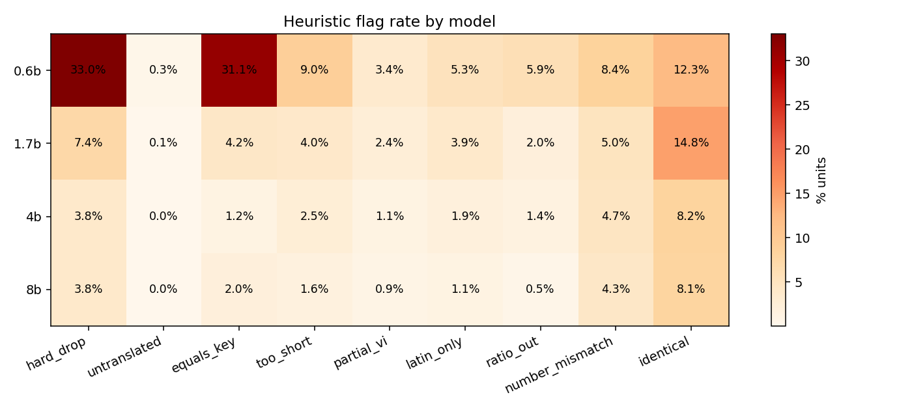
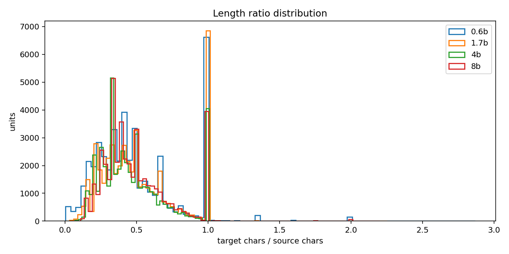
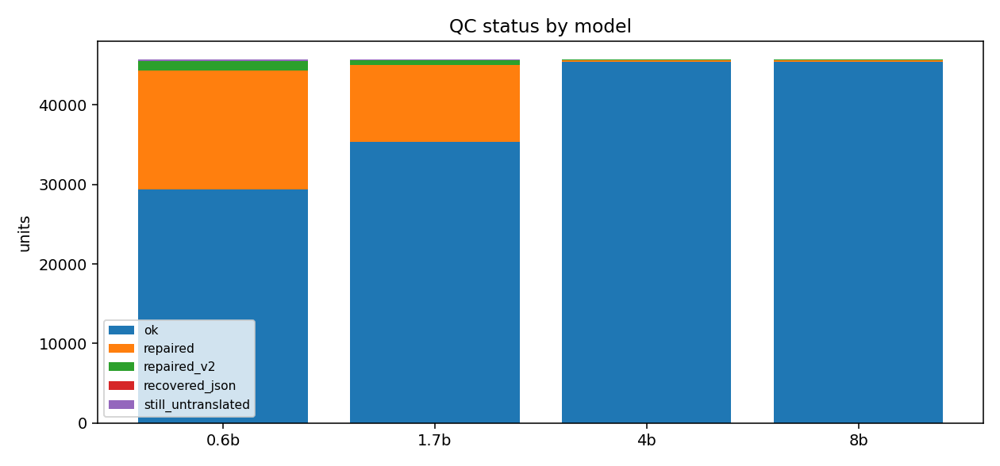
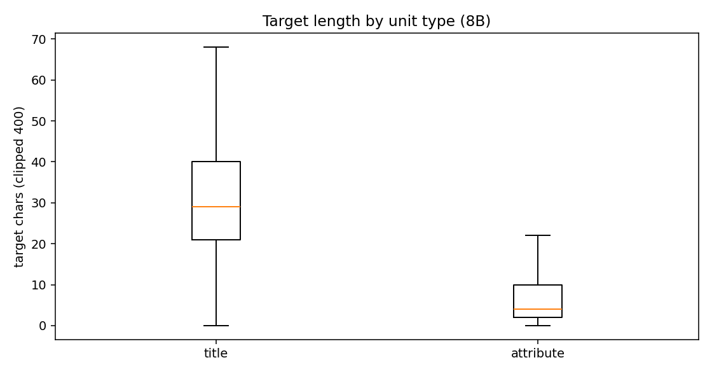

# EDA — Tập song ngữ Tiki (BT unit-level)

## 1. Quy mô

| model | units | train | dev | test | unique source | source→nhiều target | dup cặp |
|---|---|---|---|---|---|---|---|
| 0.6b | 45,709 | 36,434 | 4,824 | 4,451 | 28,620 | 528 | 16,270 |
| 1.7b | 45,709 | 36,434 | 4,824 | 4,451 | 28,620 | 359 | 16,659 |
| 4b | 45,709 | 36,434 | 4,824 | 4,451 | 28,620 | 375 | 16,656 |
| 8b | 45,709 | 36,434 | 4,824 | 4,451 | 28,620 | 353 | 16,673 |

## 2. Độ dài & tỉ lệ

| model | src p50 | src p95 | tgt p50 | tgt p95 | ratio p05 | ratio p50 | ratio p95 |
|---|---|---|---|---|---|---|---|
| 0.6b | 15 | 116 | 6 | 55 | 0.13 | 0.43 | 1.00 |
| 1.7b | 15 | 116 | 8 | 60 | 0.17 | 0.46 | 1.00 |
| 4b | 15 | 116 | 8 | 57 | 0.19 | 0.41 | 1.00 |
| 8b | 15 | 116 | 8 | 59 | 0.20 | 0.43 | 1.00 |

## 3. Cờ heuristic (% units)

| model | hard drop | untranslated | equals key | too short | partial VI | latin only | ratio out | number mismatch | identical |
|---|---|---|---|---|---|---|---|---|---|
| 0.6b | 33.01% | 0.35% | 31.13% | 8.99% | 3.43% | 5.28% | 5.94% | 8.41% | 12.31% |
| 1.7b | 7.36% | 0.11% | 4.20% | 3.99% | 2.41% | 3.85% | 1.98% | 4.97% | 14.76% |
| 4b | 3.81% | 0.02% | 1.17% | 2.54% | 1.13% | 1.91% | 1.36% | 4.69% | 8.15% |
| 8b | 3.77% | 0.02% | 2.05% | 1.64% | 0.92% | 1.06% | 0.53% | 4.27% | 8.09% |

## 4. Đồng thuận giữa model

- cặp so sánh: 45,709
- cả 4 model giống hệt: **8.61%**

| cặp | target giống hệt | cùng có/không chữ Hán |
|---|---|---|
| 0.6b|1.7b | 18.46% | 87.89% |
| 0.6b|4b | 12.02% | 88.72% |
| 0.6b|8b | 13.02% | 88.21% |
| 1.7b|4b | 22.65% | 89.84% |
| 1.7b|8b | 21.71% | 89.42% |
| 4b|8b | 30.10% | 96.86% |

## 5. Sau làm sạch

| model | giữ | loại | % giữ | test đủ | test dùng được | cặp unique (train+dev) | trùng lặp |
|---|---|---|---|---|---|---|---|
| 0.6b | 32,061 | 15,089 | 70.14% | 4,451 | 3,010 | 20,612 | 6,998 |
| 1.7b | 42,642 | 3,364 | 93.29% | 4,451 | 4,154 | 24,889 | 13,302 |
| 4b | 44,121 | 1,743 | 96.53% | 4,451 | 4,296 | 25,469 | 14,201 |
| 8b | 44,137 | 1,724 | 96.56% | 4,451 | 4,299 | 25,437 | 14,249 |

## 6. Hình

